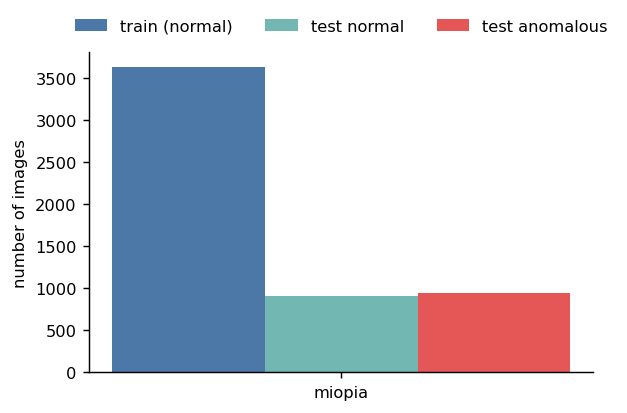
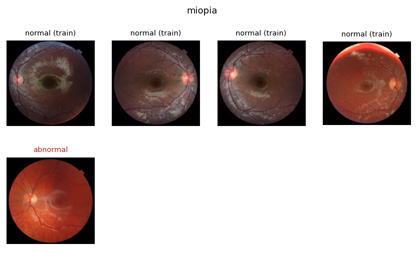
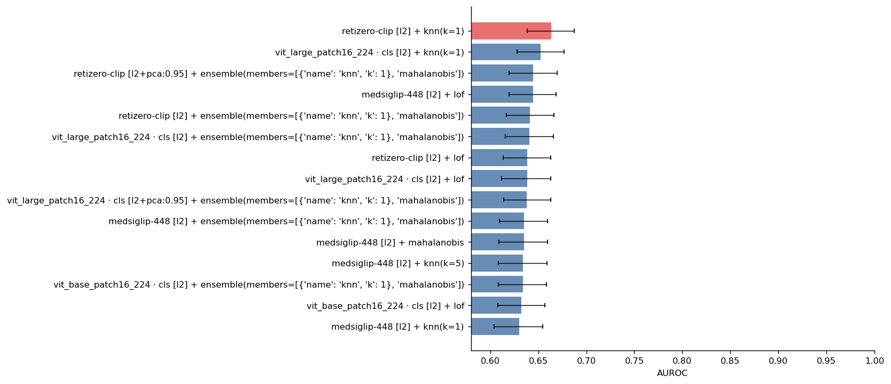
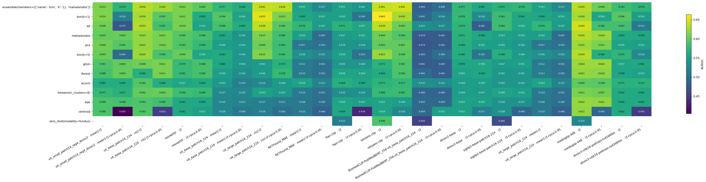
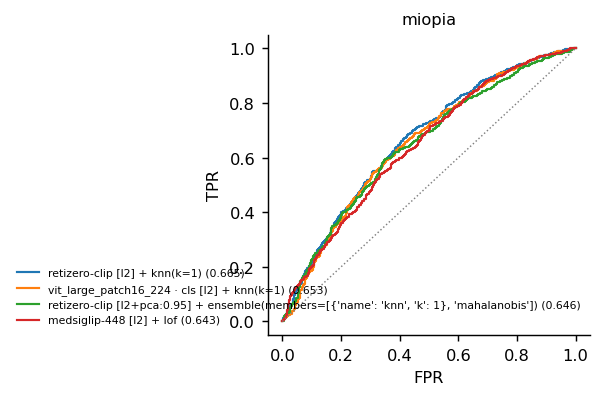
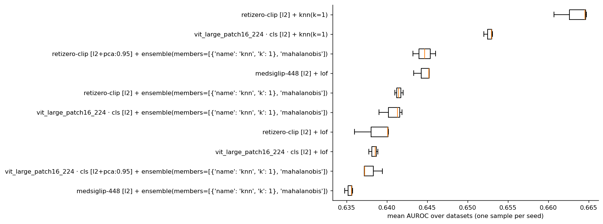

# Anomaly detection benchmark report

*Generated with `imgad` on 2026-10-19 · 1 dataset(s) · 360 configurations · main metric: AUROC*

## Summary

- **Best configuration:** retizero-clip [l2] + knn(k=1), mean AUROC **0.663**.
- Runner-up: vit_large_patch16_224 · cls [l2] + knn(k=1) (0.653; difference +0.011). DeLong: significant difference on 0 of 1 dataset(s) (α=0.05, uncorrected).
- **Extractors** (each with its best detector): retizero-clip 0.663, vit_large_patch16_224 · cls 0.653, medsiglip-448 0.645, vit_base_patch16_224 · cls 0.634, vit_small_patch14_reg4_dinov2 · mean 0.614, resnet50 0.613, dinov3-vitb16-pretrain-lvd1689m 0.596, vit_base_patch16_224 · mean 0.594, anomalydino(image_size=256) (anomalib) 0.586, siglip2-base-patch16-224 0.584, dinov2-base 0.578, RETFound_MAE · mean 0.576, vit_large_patch16_224 · mean 0.576, flair-clip 0.572, patchcore(image_size=256) (anomalib) 0.566, BiomedCLIP-PubMedBERT_256-vit_base_patch16_224 0.551, foundad(image_size=224, max_epochs=20) (anomalib) 0.551, rad(image_size=256) (anomalib) 0.550, dfm(image_size=256) (anomalib) 0.541, l2bt(image_size=224, max_epochs=20) (anomalib) 0.539, glass(image_size=256, max_epochs=20) (anomalib) 0.531, generalad(image_size=256, max_epochs=20) (anomalib) 0.529, supersimplenet(image_size=256, max_epochs=20) (anomalib) 0.528, fastflow(image_size=256, max_epochs=20) (anomalib) 0.527, mhpatchcore(image_size=256) (anomalib) 0.516, patchflow(image_size=256, max_epochs=20) (anomalib) 0.510, reverse_distillation(image_size=256, max_epochs=20) (anomalib) 0.508, uflow(image_size=256, max_epochs=20) (anomalib) 0.504, padim(image_size=256) (anomalib) 0.500, draem(image_size=256, max_epochs=20) (anomalib) 0.495, stfpm(image_size=256, max_epochs=20) (anomalib) 0.493, cflow(image_size=256, max_epochs=20) (anomalib) 0.454, uninet(image_size=256, max_epochs=20) (anomalib) 0.436
- **Detectors** (mean over extractors): best ensemble(members=[{'name': 'knn', 'k': 1}, 'mahalanobis']) 0.582, knn(k=1) 0.575, lof 0.574; worst centroid 0.519, zero_shot(modality=fundus) 0.510.

## Data analysis

**One-class** setting: models are trained on normal images only and must separate normal from anomalous images at test time.

| Dataset | Train (normal) | Test normal | Test anomalous | % anomalous | Defect types | Masks | Resolution |
|---|---:|---:|---:|---:|---:|---|---|
| miopia | 3633 | 908 | 946 | 51% | 1 | no | 2516×2448 (variable) |



*Number of images per dataset and split.*

<details><summary>Defect types per dataset</summary>

| Dataset | Type | Test images |
|---|---|---:|
| miopia | abnormal | 946 |

</details>



*Examples from miopia: normal training images (top) and one example per defect type (bottom; ground-truth mask in red when available).*

**Observations about the data**

- Mixed image resolutions in miopia (all are resized to each model's input).

## Methods

**Feature pipelines + classical detector.** Each image is mapped to an embedding by a frozen pretrained model; after preprocessing, a one-class detector fitted on the normal images assigns an anomaly score (higher = more anomalous).

Extractors:

| Extractor | Identifier | Dimension |
|---|---|---:|
| vit_small_patch14_reg4_dinov2 · mean | `vit_small_patch14_reg4_dinov2[mean]` | 384 |
| vit_base_patch16_224 · cls | `vit_base_patch16_224[cls]` | 768 |
| resnet50 | `resnet50` | 2048 |
| vit_base_patch16_224 · mean | `vit_base_patch16_224[mean]` | 768 |
| vit_large_patch16_224 · cls | `vit_large_patch16_224[cls]` | 1024 |
| RETFound_MAE · mean | `hf-hub:bitfount/RETFound_MAE[mean]` | 1024 |
| flair-clip | `flair-clip` | 512 |
| retizero-clip | `retizero-clip` | 512 |
| BiomedCLIP-PubMedBERT_256-vit_base_patch16_224 | `hf-hub:microsoft/BiomedCLIP-PubMedBERT_256-vit_base_patch16_224` | 512 |
| dinov2-base | `facebook/dinov2-base` | 768 |
| siglip2-base-patch16-224 | `google/siglip2-base-patch16-224` | 768 |
| vit_large_patch16_224 · mean | `vit_large_patch16_224[mean]` | 1024 |
| medsiglip-448 | `google/medsiglip-448` | 1152 |
| dinov3-vitb16-pretrain-lvd1689m | `facebook/dinov3-vitb16-pretrain-lvd1689m` | 768 |

Preprocessing: `l2`, `l2+pca:0.95`, `-`.

Detectors:

| Detector | Description |
|---|---|
| knn(k=1) | mean distance to the *k* nearest normal samples |
| knn(k=5) | mean distance to the *k* nearest normal samples |
| mahalanobis | Mahalanobis distance to a Gaussian fitted to the normals (shrunk covariance) |
| centroid | distance to the mean normal embedding |
| kmeans(n_clusters=8) | distance to the nearest k-means centroid of the normals |
| lof | Local Outlier Factor (local density relative to the neighbours) |
| gmm | negative log-likelihood under a Gaussian mixture |
| kde | negative log-density of a kernel density estimate |
| ocsvm | One-Class SVM (boundary enclosing the normals) |
| iforest | Isolation Forest (how easily random splits isolate a point) |
| pca | reconstruction error in the PCA subspace of the normals |
| ensemble(members=[{'name': 'knn', 'k': 1}, 'mahalanobis']) | mean of the normalised scores of several detectors |
| zero_shot(modality=fundus) | – |

**Anomalib models** (end-to-end, with pixel-level anomaly maps). Raw model scores and maps are used; Anomalib's post-processing (which needs labelled anomalies) is disabled.

| Model | Description |
|---|---|
| patchcore(image_size=256) | memory bank of patch features from a pretrained CNN; score = distance to the nearest normal patch |
| mhpatchcore(image_size=256) | – |
| padim(image_size=256) | per-position multivariate Gaussian over CNN patch features |
| dfm(image_size=256) | density model on deep features (PCA + Gaussian) |
| anomalydino(image_size=256) | – |
| cflow(image_size=256, max_epochs=20) | conditional normalizing flow over patch features |
| fastflow(image_size=256, max_epochs=20) | 2D normalizing flow over CNN features; anomaly = low likelihood |
| uflow(image_size=256, max_epochs=20) | – |
| stfpm(image_size=256, max_epochs=20) | student-teacher feature pyramid; anomaly = their discrepancy |
| reverse_distillation(image_size=256, max_epochs=20) | reverse distillation encoder-decoder; anomaly = feature reconstruction error |
| uninet(image_size=256, max_epochs=20) | – |
| draem(image_size=256, max_epochs=20) | reconstruction + segmentation trained with synthetic anomalies |
| supersimplenet(image_size=256, max_epochs=20) | – |
| glass(image_size=256, max_epochs=20) | – |
| generalad(image_size=256, max_epochs=20) | – |
| foundad(image_size=224, max_epochs=20) | – |
| rad(image_size=256) | – |
| patchflow(image_size=256, max_epochs=20) | – |
| l2bt(image_size=224, max_epochs=20) | – |

**Protocol.**

- Training on normal images only; testing on normal and anomalous images.
- Decision threshold: quantile 0.95 of *out-of-sample* normal scores (cross-validation or leave-one-out for detectors; a held-out split for anomalib). No anomaly is used.
- Main metric: **AUROC**. Also AUPR, F1-max (best F1 over all thresholds), FPR@95%TPR and TPR/FPR/F1 at the automatic threshold.
- Repetitions: 3 seed(s) (0, 1, 2). Each seed uses a different subset of the normal training images.
- 95% confidence intervals by stratified bootstrap of the test set.
- Statistical tests: DeLong test to compare AUROCs on the same test images (α=0.05).

## Results

### Ranking of configurations

Mean over the dataset and seeds; top 15 of 360 shown.

| # | Configuration | mean AUROC | ± std over seeds | AUPR | F1-max |
|---:|---|---:|---:|---:|---:|
| 1 | retizero-clip [l2] + knn(k=1) | **0.663** | 0.002 | 0.643 | 0.694 |
| 2 | vit_large_patch16_224 · cls [l2] + knn(k=1) | 0.653 | 0.001 | 0.620 | 0.691 |
| 3 | retizero-clip [l2+pca:0.95] + ensemble(members=[{'name': 'knn', 'k': 1}, 'mahalanobis']) | 0.645 | 0.001 | 0.627 | 0.687 |
| 4 | medsiglip-448 [l2] + lof | 0.645 | 0.001 | 0.628 | 0.694 |
| 5 | retizero-clip [l2] + ensemble(members=[{'name': 'knn', 'k': 1}, 'mahalanobis']) | 0.641 | 0.001 | 0.621 | 0.688 |
| 6 | vit_large_patch16_224 · cls [l2] + ensemble(members=[{'name': 'knn', 'k': 1}, 'mahalanobis']) | 0.641 | 0.002 | 0.611 | 0.693 |
| 7 | retizero-clip [l2] + lof | 0.639 | 0.002 | 0.606 | 0.684 |
| 8 | vit_large_patch16_224 · cls [l2] + lof | 0.638 | 0.001 | 0.603 | 0.688 |
| 9 | vit_large_patch16_224 · cls [l2+pca:0.95] + ensemble(members=[{'name': 'knn', 'k': 1}, 'mahalanobis']) | 0.638 | 0.001 | 0.610 | 0.682 |
| 10 | medsiglip-448 [l2] + ensemble(members=[{'name': 'knn', 'k': 1}, 'mahalanobis']) | 0.635 | 0.001 | 0.636 | 0.682 |
| 11 | medsiglip-448 [l2] + mahalanobis | 0.635 | 0.001 | 0.635 | 0.682 |
| 12 | medsiglip-448 [l2] + knn(k=5) | 0.634 | 0.001 | 0.635 | 0.681 |
| 13 | vit_base_patch16_224 · cls [l2] + ensemble(members=[{'name': 'knn', 'k': 1}, 'mahalanobis']) | 0.634 | 0.003 | 0.613 | 0.687 |
| 14 | vit_base_patch16_224 · cls [l2] + lof | 0.633 | 0.003 | 0.613 | 0.686 |
| 15 | medsiglip-448 [l2] + knn(k=1) | 0.630 | 0.001 | 0.632 | 0.682 |



*Mean AUROC of the best configurations (error bars = bootstrap CI).*

### Mean AUROC: extractor × detector

| Detector | vit_small_patch14_reg4_dinov2 · mean] l2 | vit_small_patch14_reg4_dinov2 · mean] l2+pca:0.95 | vit_base_patch16_224 · cls] l2 | vit_base_patch16_224 · cls] l2+pca:0.95 | resnet50  · l2 | resnet50  · l2+pca:0.95 | vit_base_patch16_224 · mean] l2 | vit_base_patch16_224 · mean] l2+pca:0.95 | vit_large_patch16_224 · cls] l2 | vit_large_patch16_224 · cls] l2+pca:0.95 | RETFound_MAE · mean] l2 | RETFound_MAE · mean] l2+pca:0.95 | flair-clip  · l2 | flair-clip  · l2+pca:0.95 | retizero-clip  · l2 | retizero-clip  · l2+pca:0.95 | BiomedCLIP-PubMedBERT_256-vit_base_patch16_224  · l2 | BiomedCLIP-PubMedBERT_256-vit_base_patch16_224  · l2+pca:0.95 | dinov2-base  · l2 | dinov2-base  · l2+pca:0.95 | siglip2-base-patch16-224  · l2 | siglip2-base-patch16-224  · l2+pca:0.95 | vit_large_patch16_224 · mean] l2 | vit_large_patch16_224 · mean] l2+pca:0.95 | medsiglip-448  · l2 | medsiglip-448  · l2+pca:0.95 | dinov3-vitb16-pretrain-lvd1689m  · l2 | dinov3-vitb16-pretrain-lvd1689m  · l2+pca:0.95 |
|---|---:|---:|---:|---:|---:|---:|---:|---:|---:|---:|---:|---:|---:|---:|---:|---:|---:|---:|---:|---:|---:|---:|---:|---:|---:|---:|---:|---:|
| ensemble(members=[{'name': 'knn', 'k': 1}, 'mahalanobis']) | 0.613 | 0.574 | 0.634 | 0.626 | 0.613 | 0.600 | 0.577 | 0.566 | 0.641 | 0.638 | 0.553 | 0.527 | 0.551 | 0.542 | 0.641 | 0.645 | 0.484 | 0.498 | 0.577 | 0.561 | 0.572 | 0.576 | 0.553 | 0.527 | 0.635 | 0.606 | 0.583 | 0.574 |
| knn(k=1) | 0.614 | 0.516 | 0.630 | 0.597 | 0.612 | 0.563 | 0.594 | 0.554 | 0.653 | 0.612 | 0.560 | 0.551 | 0.550 | 0.504 | **0.663** | 0.630 | 0.492 | 0.516 | 0.578 | 0.530 | 0.582 | 0.561 | 0.560 | 0.551 | 0.630 | 0.556 | 0.596 | 0.550 |
| lof | 0.608 | 0.475 | 0.633 | 0.587 | 0.610 | 0.554 | 0.588 | 0.565 | 0.638 | 0.596 | 0.576 | 0.547 | 0.572 | 0.557 | 0.639 | 0.605 | 0.533 | 0.527 | 0.574 | 0.482 | 0.584 | 0.556 | 0.576 | 0.547 | 0.645 | 0.586 | 0.587 | 0.513 |
| mahalanobis | 0.602 | 0.603 | 0.623 | 0.611 | 0.596 | 0.588 | 0.561 | 0.538 | 0.613 | 0.586 | 0.550 | 0.497 | 0.547 | 0.552 | 0.606 | 0.594 | 0.479 | 0.481 | 0.571 | 0.560 | 0.553 | 0.550 | 0.550 | 0.497 | 0.635 | 0.624 | 0.563 | 0.559 |
| pca | 0.608 | 0.595 | 0.621 | 0.610 | 0.593 | 0.580 | 0.549 | 0.543 | 0.606 | 0.583 | 0.507 | 0.503 | 0.538 | 0.538 | 0.602 | 0.601 | 0.474 | 0.481 | 0.568 | 0.552 | 0.550 | 0.540 | 0.507 | 0.503 | 0.625 | 0.612 | 0.555 | 0.551 |
| knn(k=5) | 0.605 | 0.495 | 0.624 | 0.590 | 0.604 | 0.556 | 0.563 | 0.540 | 0.615 | 0.584 | 0.536 | 0.525 | 0.550 | 0.503 | 0.623 | 0.598 | 0.483 | 0.499 | 0.566 | 0.505 | 0.568 | 0.546 | 0.536 | 0.525 | 0.634 | 0.566 | 0.575 | 0.526 |
| gmm | 0.593 | 0.601 | 0.606 | 0.611 | 0.579 | 0.588 | 0.560 | 0.540 | 0.545 | 0.570 | 0.512 | 0.502 | 0.539 | 0.540 | 0.572 | 0.592 | 0.481 | 0.483 | 0.558 | 0.558 | 0.547 | 0.551 | 0.512 | 0.502 | 0.624 | 0.624 | 0.557 | 0.561 |
| iforest | 0.589 | 0.603 | 0.568 | 0.611 | 0.581 | 0.588 | 0.550 | 0.534 | 0.546 | 0.578 | 0.513 | 0.502 | 0.556 | 0.554 | 0.564 | 0.590 | 0.495 | 0.482 | 0.555 | 0.559 | 0.542 | 0.541 | 0.513 | 0.502 | 0.621 | 0.618 | 0.558 | 0.553 |
| ocsvm | 0.565 | 0.565 | 0.594 | 0.566 | 0.557 | 0.563 | 0.543 | 0.516 | 0.524 | 0.546 | 0.554 | 0.521 | 0.568 | 0.560 | 0.573 | 0.577 | 0.535 | 0.531 | 0.548 | 0.550 | 0.540 | 0.541 | 0.554 | 0.521 | 0.600 | 0.598 | 0.571 | 0.572 |
| kmeans(n_clusters=8) | 0.577 | 0.571 | 0.602 | 0.603 | 0.584 | 0.580 | 0.527 | 0.526 | 0.553 | 0.543 | 0.510 | 0.501 | 0.532 | 0.534 | 0.580 | 0.581 | 0.490 | 0.490 | 0.549 | 0.547 | 0.556 | 0.551 | 0.510 | 0.501 | 0.611 | 0.607 | 0.562 | 0.562 |
| kde | 0.590 | 0.588 | 0.592 | 0.586 | 0.561 | 0.559 | 0.525 | 0.521 | 0.517 | 0.511 | 0.508 | 0.500 | 0.556 | 0.552 | 0.553 | 0.549 | 0.493 | 0.494 | 0.553 | 0.552 | 0.538 | 0.537 | 0.508 | 0.500 | 0.622 | 0.621 | 0.562 | 0.561 |
| centroid | 0.590 | 0.405 | 0.593 | 0.453 | 0.561 | 0.551 | 0.526 | 0.509 | 0.516 | 0.500 | 0.510 | 0.486 | 0.559 | 0.434 | 0.554 | 0.528 | 0.494 | 0.551 | 0.553 | 0.517 | 0.538 | 0.490 | 0.510 | 0.486 | 0.621 | 0.490 | 0.562 | 0.450 |
| zero_shot(modality=fundus) | – | – | – | – | – | – | – | – | – | – | – | – | 0.515 | – | 0.590 | – | 0.456 | – | – | – | 0.466 | – | – | – | 0.525 | – | – | – |
| *mean* | *0.596* | *0.549* | *0.610* | *0.588* | *0.588* | *0.573* | *0.555* | *0.538* | *0.581* | *0.571* | *0.532* | *0.513* | *0.549* | *0.531* | *0.597* | *0.591* | *0.492* | *0.503* | *0.563* | *0.539* | *0.549* | *0.545* | *0.532* | *0.513* | *0.618* | *0.592* | *0.569* | *0.544* |



*Mean AUROC per extractor and detector.*

### Results per dataset

| Dataset | Best configuration | AUROC | CI (bootstrap) | Runner-up | AUROC | Overall best |
|---|---|---|---|---|---:|---:|
| miopia | retizero-clip [l2] + knn(k=1) | 0.663 | [0.638, 0.688] | vit_large_patch16_224 · cls [l2] + knn(k=1) | 0.653 | 0.663 |

### ROC curves



*ROC curves of the 4 best configurations on each dataset (first seed; AUROC in brackets).*

![Test score distribution of the best configuration (retizero-clip [l2] + knn(k=1)) with the automatic threshold.](figures/results_scores.png)

*Test score distribution of the best configuration (retizero-clip [l2] + knn(k=1)) with the automatic threshold.*

### Operating point with the automatic threshold

Best configuration (retizero-clip [l2] + knn(k=1)); threshold = quantile 0.95 of out-of-sample normal scores, so the expected FPR on normal images is ≈ 5%.

| Dataset | AUROC | AUPR | F1-max | FPR@95%TPR | TPR@thr | FPR@thr | F1@thr |
|---|---:|---:|---:|---:|---:|---:|---:|
| miopia | 0.663 | 0.643 | 0.694 | 0.836 | 0.144 | 0.065 | 0.239 |

### Variability across seeds

Standard deviation of AUROC across seeds: median 0.0014, max 0.0639.



*Spread across seeds of the best configurations.*

### DeLong test against the best configuration

| Versus | ΔAUROC (best − other) | 95% CI | p |
|---|---:|---:|---:|
| vit_large_patch16_224 · cls [l2] + knn(k=1) | +0.012 | [-0.006, +0.030] | 0.208 |
| retizero-clip [l2+pca:0.95] + ensemble(members=[{'name': 'knn', 'k': 1}, 'mahalanobis']) | +0.019 | [+0.007, +0.030] | 0.00136 * |
| medsiglip-448 [l2] + lof | +0.021 | [-0.004, +0.046] | 0.0979 |
| retizero-clip [l2] + ensemble(members=[{'name': 'knn', 'k': 1}, 'mahalanobis']) | +0.023 | [+0.013, +0.032] | 3.01e-06 * |
| vit_large_patch16_224 · cls [l2] + ensemble(members=[{'name': 'knn', 'k': 1}, 'mahalanobis']) | +0.023 | [+0.003, +0.042] | 0.0217 * |
| retizero-clip [l2] + lof | +0.029 | [+0.009, +0.048] | 0.00428 * |
| vit_large_patch16_224 · cls [l2] + lof | +0.027 | [+0.005, +0.049] | 0.0166 * |
| vit_large_patch16_224 · cls [l2+pca:0.95] + ensemble(members=[{'name': 'knn', 'k': 1}, 'mahalanobis']) | +0.027 | [+0.007, +0.048] | 0.00829 * |
| medsiglip-448 [l2] + ensemble(members=[{'name': 'knn', 'k': 1}, 'mahalanobis']) | +0.029 | [+0.003, +0.055] | 0.0317 * |
| medsiglip-448 [l2] + mahalanobis | +0.030 | [+0.003, +0.056] | 0.0272 * |
| medsiglip-448 [l2] + knn(k=5) | +0.031 | [+0.004, +0.058] | 0.0227 * |
| vit_base_patch16_224 · cls [l2] + ensemble(members=[{'name': 'knn', 'k': 1}, 'mahalanobis']) | +0.032 | [+0.004, +0.059] | 0.0231 * |
| vit_base_patch16_224 · cls [l2] + lof | +0.030 | [+0.002, +0.057] | 0.0328 * |
| medsiglip-448 [l2] + knn(k=1) | +0.034 | [+0.007, +0.060] | 0.0133 * |
| retizero-clip [l2+pca:0.95] + knn(k=1) | +0.034 | [+0.016, +0.053] | 0.000318 * |
| vit_base_patch16_224 · cls [l2] + knn(k=1) | +0.037 | [+0.010, +0.065] | 0.00725 * |
| vit_base_patch16_224 · cls [l2+pca:0.95] + ensemble(members=[{'name': 'knn', 'k': 1}, 'mahalanobis']) | +0.039 | [+0.012, +0.066] | 0.00478 * |
| medsiglip-448 [l2] + pca | +0.039 | [+0.012, +0.066] | 0.00466 * |
| vit_base_patch16_224 · cls [l2] + knn(k=5) | +0.040 | [+0.013, +0.068] | 0.00396 * |
| medsiglip-448 [l2+pca:0.95] + mahalanobis | +0.040 | [+0.012, +0.067] | 0.00436 * |
| medsiglip-448 [l2+pca:0.95] + gmm | +0.040 | [+0.013, +0.068] | 0.00401 * |
| medsiglip-448 [l2] + gmm | +0.038 | [+0.008, +0.067] | 0.0117 * |
| retizero-clip [l2] + knn(k=5) | +0.041 | [+0.030, +0.052] | 9.56e-13 * |
| vit_base_patch16_224 · cls [l2] + mahalanobis | +0.041 | [+0.013, +0.070] | 0.00456 * |
| medsiglip-448 [l2] + kde | +0.042 | [+0.011, +0.073] | 0.00771 * |

### Computational cost

Mean times per dataset (seconds; feature extraction is cached and shared across detectors and seeds).

| Method | Feature extraction | Detector fit+test | Training (anomalib) | Test (anomalib) |
|---|---:|---:|---:|---:|
| vit_small_patch14_reg4_dinov2 · mean | 0.4 | 1.734 | – | – |
| vit_base_patch16_224 · cls | 0.4 | 3.289 | – | – |
| resnet50 | 0.4 | 16.529 | – | – |
| vit_base_patch16_224 · mean | 0.4 | 2.625 | – | – |
| vit_large_patch16_224 · cls | 0.4 | 4.057 | – | – |
| RETFound_MAE · mean | 0.4 | 4.051 | – | – |
| flair-clip | 0.4 | 1.905 | – | – |
| retizero-clip | 0.4 | 2.023 | – | – |
| BiomedCLIP-PubMedBERT_256-vit_base_patch16_224 | 0.4 | 1.970 | – | – |
| dinov2-base | 0.4 | 2.910 | – | – |
| siglip2-base-patch16-224 | 0.4 | 2.694 | – | – |
| vit_large_patch16_224 · mean | 0.5 | 4.016 | – | – |
| medsiglip-448 | 0.4 | 4.178 | – | – |
| dinov3-vitb16-pretrain-lvd1689m | 0.4 | 2.904 | – | – |
| patchcore(image_size=256) (anomalib) | – | – | 3499.8 | 174.3 |
| mhpatchcore(image_size=256) (anomalib) | – | – | 1365.0 | 130.9 |
| padim(image_size=256) (anomalib) | – | – | 192.3 | 104.8 |
| dfm(image_size=256) (anomalib) | – | – | 180.9 | 96.5 |
| anomalydino(image_size=256) (anomalib) | – | – | 153.3 | 118.6 |
| cflow(image_size=256, max_epochs=20) (anomalib) | – | – | 12833.6 | 209.9 |
| fastflow(image_size=256, max_epochs=20) (anomalib) | – | – | 2450.9 | 92.0 |
| uflow(image_size=256, max_epochs=20) (anomalib) | – | – | 7133.4 | 279.6 |
| stfpm(image_size=256, max_epochs=20) (anomalib) | – | – | 2426.1 | 93.3 |
| reverse_distillation(image_size=256, max_epochs=20) (anomalib) | – | – | 2568.2 | 94.9 |
| uninet(image_size=256, max_epochs=20) (anomalib) | – | – | 2876.1 | 93.1 |
| draem(image_size=256, max_epochs=20) (anomalib) | – | – | 3764.0 | 105.0 |
| supersimplenet(image_size=256, max_epochs=20) (anomalib) | – | – | 3159.3 | 98.7 |
| glass(image_size=256, max_epochs=20) (anomalib) | – | – | 6301.9 | 110.0 |
| generalad(image_size=256, max_epochs=20) (anomalib) | – | – | 2916.3 | 104.6 |
| foundad(image_size=224, max_epochs=20) (anomalib) | – | – | 2686.9 | 95.8 |
| rad(image_size=256) (anomalib) | – | – | 240.8 | 111.3 |
| patchflow(image_size=256, max_epochs=20) (anomalib) | – | – | 2475.6 | 96.0 |
| l2bt(image_size=224, max_epochs=20) (anomalib) | – | – | 2402.2 | 90.7 |


## Discussion

**What matters more, the extractor or the detector?** With a fixed extractor, changing the detector moves the mean AUROC by 0.091 on average (best minus worst detector); with a fixed detector, changing the extractor moves it by 0.148. On these data **the extractor** matters more.

The best detector is ensemble(members=[{'name': 'knn', 'k': 1}, 'mahalanobis']) with 10 of 28 extractors (with the others, centroid, knn(k=1), lof, mahalanobis, ocsvm wins).

The worst detector is centroid with 13 of 28 extractors.

**Significance.** According to DeLong, the best configuration has a significantly higher AUROC (α=0.05, uncorrected for multiple comparisons) than 356 of the other 358.

The median width of the 95% AUROC CI is 0.052: smaller differences between configurations on the same dataset are not conclusive.

**Anomalib vs. global features.** The best anomalib model (anomalydino(image_size=256) (anomalib), 0.586) falls behind the best features + detector combination (retizero-clip [l2] + knn(k=1), 0.663; difference -0.078); it also produces anomaly maps that localise the defect.

**Automatic threshold.** Calibrated on normal images only (quantile 0.95), it detects 14% of the anomalies on average with the best configuration. The test FPR stays close to the expected one (≈5%).


## Limitations

- The best configuration is chosen on the test set, so its performance is an optimistic estimate. An unbiased selection needs a separate validation set.
- Default hyperparameters, no tuning.
- Image-level metrics only: defect localisation is not evaluated.
- Too few datasets to generalise the conclusions or to run powerful across-dataset tests.

## Failed runs

2 run(s) failed and are excluded from every table and test above:

| Dataset | Configuration | Stage | Error |
|---|---:|---:|---:|
| miopia | vit_large_patch14_dinov2[mean] \| - \| - | extract | AssertionError: Input height (518) doesn't match model (224). |
| miopia | anomalib \| - \| draem(image_size=256, max_epochs=20) | anomalib | TypeError: cannot pickle 'BufferedReader' instances |

## Reproducibility

Files in this folder: `report.md`, `results.csv` (one row per dataset × configuration × seed), `config.yaml` and 7 figures in `figures/`.

```bash
imgad benchmark --config configs/miopia_benchmark.yaml --report report/ -j 8 --devices auto --hf-token-file token
```

<details><summary>Configuration</summary>

```yaml
data:
  type: folders
  name: miopia
  train_normal: anomalib_dataset/normal/train
  test_normal: anomalib_dataset/normal/test
  test_anomalous:
  - anomalib_dataset/abnormal
cache_dir: .feature_cache
seeds:
- 0
- 1
- 2
train_subsample: 0.8
bootstrap: 1000
ci_alpha: 0.05
on_error: continue
extractors:
- zoo:retfound-green
- zoo:visionfm-fundus
- zoo:flair
- zoo:urfound
- zoo:retizero
- zoo:retfound-cfp-mirror
- zoo:flair-clip
- zoo:retizero-clip
- zoo:biomedclip
- zoo:dinov2-base
- zoo:siglip2-base
- zoo:retfound-cfp
- zoo:retfound-dinov2
- zoo:medsiglip
- zoo:dinov3-vitb16
preprocessing:
- - l2
- - l2
  - pca:0.95
detectors:
- name: knn
  k: 1
- name: knn
  k: 5
- mahalanobis
- centroid
- name: kmeans
  n_clusters: 8
- lof
- gmm
- kde
- ocsvm
- iforest
- pca
- name: ensemble
  members:
  - name: knn
    k: 1
  - mahalanobis
- name: zero_shot
  modality: fundus
anomalib:
- name: patchcore
  image_size: 256
- name: mhpatchcore
  image_size: 256
- name: padim
  image_size: 256
- name: dfm
  image_size: 256
- name: anomalydino
  image_size: 256
- name: cflow
  image_size: 256
  max_epochs: 20
- name: fastflow
  image_size: 256
  max_epochs: 20
- name: uflow
  image_size: 256
  max_epochs: 20
- name: stfpm
  image_size: 256
  max_epochs: 20
- name: reverse_distillation
  image_size: 256
  max_epochs: 20
- name: uninet
  image_size: 256
  max_epochs: 20
- name: draem
  image_size: 256
  max_epochs: 20
- name: supersimplenet
  image_size: 256
  max_epochs: 20
- name: glass
  image_size: 256
  max_epochs: 20
- name: generalad
  image_size: 256
  max_epochs: 20
- name: foundad
  image_size: 224
  max_epochs: 20
- name: rad
  image_size: 256
- name: patchflow
  image_size: 256
  max_epochs: 20
- name: l2bt
  image_size: 224
  max_epochs: 20
```

</details>

Environment: imgad 0.6.0, Python 3.12.3, torch 2.11.0+cu128, transformers 5.17.0, sklearn 1.8.0, anomalib 2.7.0, GPU NVIDIA RTX PRO 6000 Blackwell Max-Q Workstation Edition, Linux-5.14.0-611.45.1.el9_7.x86_64-x86_64-with-glibc2.35.
