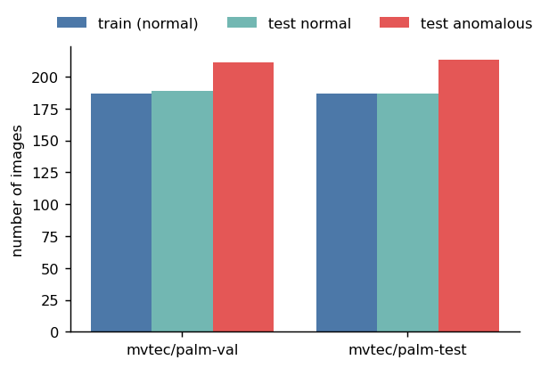
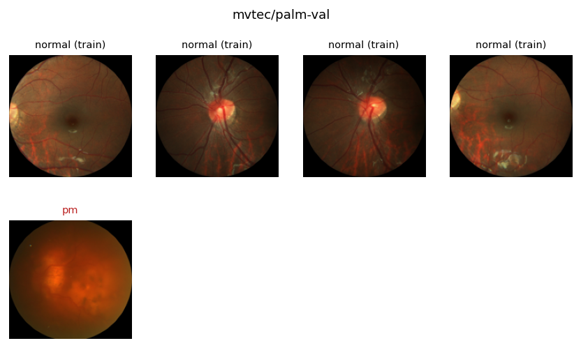
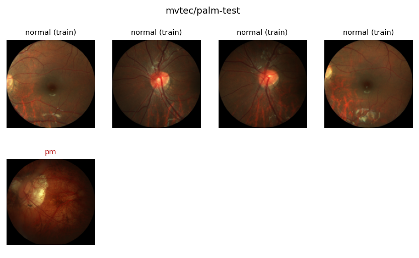
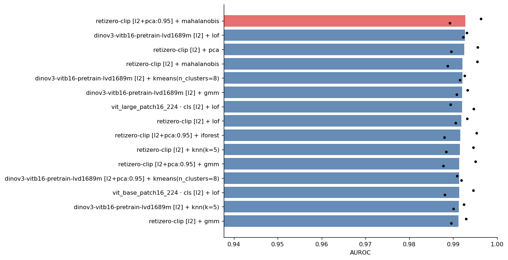
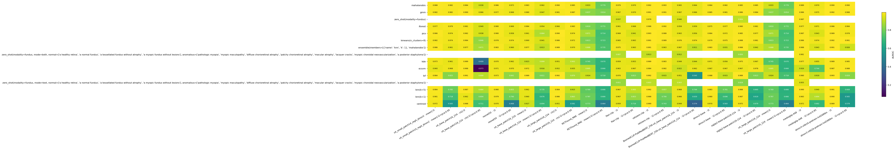
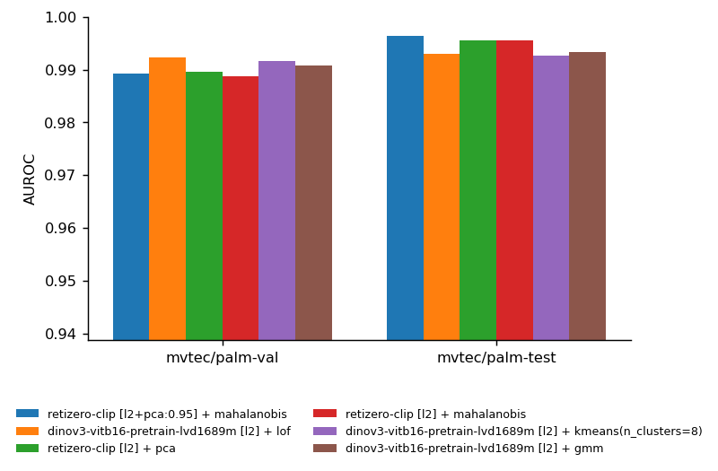
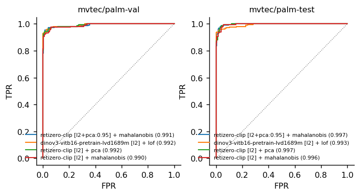
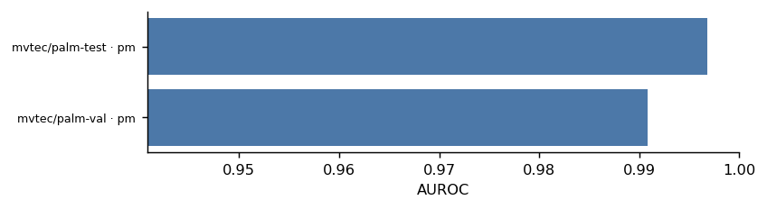
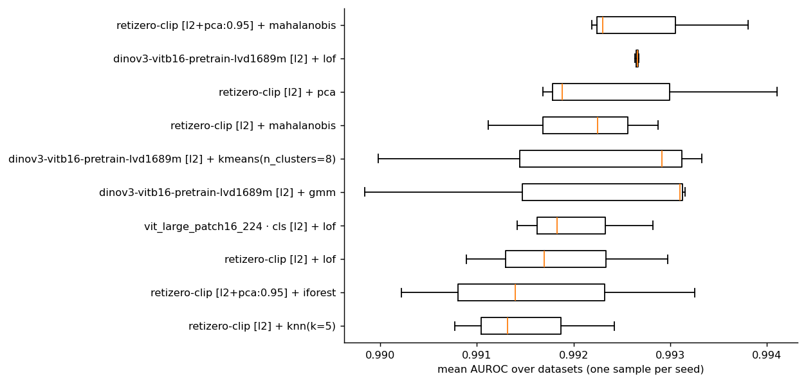
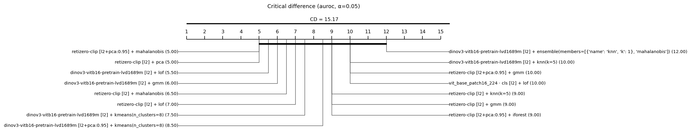

# Anomaly detection benchmark report

*Generated with `imgad` on 2026-10-20 · 2 dataset(s) · 370 configurations · main metric: AUROC*

## Summary

- **Best configuration:** retizero-clip [l2+pca:0.95] + mahalanobis, mean AUROC **0.993** over the 2 datasets.
- Runner-up: dinov3-vitb16-pretrain-lvd1689m [l2] + lof (0.993; difference +0.000). The difference is **not** significant across datasets (Wilcoxon-Holm p=1).
- **Extractors** (each with its best detector): retizero-clip 0.993, dinov3-vitb16-pretrain-lvd1689m 0.993, vit_large_patch16_224 · cls 0.992, vit_base_patch16_224 · cls 0.991, medsiglip-448 0.990, siglip2-base-patch16-224 0.989, vit_base_patch16_224 · mean 0.989, vit_small_patch14_reg4_dinov2 · mean 0.988, dinov2-base 0.988, rad(image_size=256) (anomalib) 0.987, dfm(image_size=256) (anomalib) 0.987, resnet50 0.986, flair-clip 0.979, BiomedCLIP-PubMedBERT_256-vit_base_patch16_224 0.976, patchflow(image_size=256, max_epochs=20) (anomalib) 0.975, patchcore(image_size=256) (anomalib) 0.973, anomalydino(image_size=256) (anomalib) 0.966, foundad(image_size=224, max_epochs=20) (anomalib) 0.961, l2bt(image_size=224, max_epochs=20) (anomalib) 0.953, mhpatchcore(image_size=256) (anomalib) 0.948, fastflow(image_size=256, max_epochs=20) (anomalib) 0.935, reverse_distillation(image_size=256, max_epochs=20) (anomalib) 0.933, RETFound_MAE · mean 0.933, vit_large_patch16_224 · mean 0.933, generalad(image_size=256, max_epochs=20) (anomalib) 0.896, padim(image_size=256) (anomalib) 0.883, stfpm(image_size=256, max_epochs=20) (anomalib) 0.843, uflow(image_size=256, max_epochs=20) (anomalib) 0.775, glass(image_size=256, max_epochs=20) (anomalib) 0.726, uninet(image_size=256, max_epochs=20) (anomalib) 0.675, supersimplenet(image_size=256, max_epochs=20) (anomalib) 0.524, draem(image_size=256, max_epochs=20) (anomalib) 0.477, cflow(image_size=256, max_epochs=20) (anomalib) 0.369
- **Detectors** (mean over extractors): best mahalanobis 0.962, gmm 0.957, zero_shot(modality=fundus) 0.949; worst knn(k=1) 0.840, centroid 0.767.
- **Hardest dataset:** mvtec/palm-val (best AUROC 0.995, vit_large_patch16_224 · cls [l2] + lof).
- Picking the best configuration on each dataset would give a mean AUROC of 0.995 (optimistic bound: the choice is made on the test set).

## Data analysis

**One-class** setting: models are trained on normal images only and must separate normal from anomalous images at test time.

| Dataset | Train (normal) | Test normal | Test anomalous | % anomalous | Defect types | Masks | Resolution |
|---|---:|---:|---:|---:|---:|---|---|
| mvtec/palm-val | 187 | 189 | 211 | 53% | 1 | no | 2124×2056 (variable) |
| mvtec/palm-test | 187 | 187 | 213 | 53% | 1 | no | 2124×2056 (variable) |



*Number of images per dataset and split.*

<details><summary>Defect types per dataset</summary>

| Dataset | Type | Test images |
|---|---|---:|
| mvtec/palm-val | pm | 211 |
| mvtec/palm-test | pm | 213 |

</details>



*Examples from mvtec/palm-val: normal training images (top) and one example per defect type (bottom; ground-truth mask in red when available).*



*Examples from mvtec/palm-test: normal training images (top) and one example per defect type (bottom; ground-truth mask in red when available).*

**Observations about the data**

- Mixed image resolutions in mvtec/palm-val, mvtec/palm-test (all are resized to each model's input).

## Methods

**Feature pipelines + classical detector.** Each image is mapped to an embedding by a frozen pretrained model; after preprocessing, a one-class detector fitted on the normal images assigns an anomaly score (higher = more anomalous).

Extractors:

| Extractor | Identifier | Dimension |
|---|---|---:|
| vit_small_patch14_reg4_dinov2 · mean | `vit_small_patch14_reg4_dinov2[mean]` | 384 |
| vit_base_patch16_224 · cls | `vit_base_patch16_224[cls]` | 768 |
| resnet50 | `resnet50` | 2048 |
| vit_base_patch16_224 · mean | `vit_base_patch16_224[mean]` | 768 |
| vit_large_patch16_224 · cls | `vit_large_patch16_224[cls]` | 1024 |
| RETFound_MAE · mean | `hf-hub:bitfount/RETFound_MAE[mean]` | 1024 |
| flair-clip | `flair-clip` | 512 |
| retizero-clip | `retizero-clip` | 512 |
| BiomedCLIP-PubMedBERT_256-vit_base_patch16_224 | `hf-hub:microsoft/BiomedCLIP-PubMedBERT_256-vit_base_patch16_224` | 512 |
| dinov2-base | `facebook/dinov2-base` | 768 |
| siglip2-base-patch16-224 | `google/siglip2-base-patch16-224` | 768 |
| vit_large_patch16_224 · mean | `vit_large_patch16_224[mean]` | 1024 |
| medsiglip-448 | `google/medsiglip-448` | 1152 |
| dinov3-vitb16-pretrain-lvd1689m | `facebook/dinov3-vitb16-pretrain-lvd1689m` | 768 |

Preprocessing: `l2`, `l2+pca:0.95`, `-`.

Detectors:

| Detector | Description |
|---|---|
| knn(k=1) | mean distance to the *k* nearest normal samples |
| knn(k=5) | mean distance to the *k* nearest normal samples |
| mahalanobis | Mahalanobis distance to a Gaussian fitted to the normals (shrunk covariance) |
| centroid | distance to the mean normal embedding |
| kmeans(n_clusters=8) | distance to the nearest k-means centroid of the normals |
| lof | Local Outlier Factor (local density relative to the neighbours) |
| gmm | negative log-likelihood under a Gaussian mixture |
| kde | negative log-density of a kernel density estimate |
| ocsvm | One-Class SVM (boundary enclosing the normals) |
| iforest | Isolation Forest (how easily random splits isolate a point) |
| pca | reconstruction error in the PCA subspace of the normals |
| ensemble(members=[{'name': 'knn', 'k': 1}, 'mahalanobis']) | mean of the normalised scores of several detectors |
| zero_shot(modality=fundus) | – |
| zero_shot(modality=fundus, mode=text, normal=['a healthy retina', 'a normal fundus', 'a tessellated fundus without atrophy', 'a myopic fundus without lesions'], anomalous=['pathologic myopia', 'myopic maculopathy', 'diffuse chorioretinal atrophy', 'patchy chorioretinal atrophy', 'macular atrophy', 'lacquer cracks', 'myopic choroidal neovascularization', 'a posterior staphyloma']) | – |
| zero_shot(modality=fundus, mode=both, normal=['a healthy retina', 'a normal fundus', 'a tessellated fundus without atrophy', 'a myopic fundus without lesions'], anomalous=['pathologic myopia', 'myopic maculopathy', 'diffuse chorioretinal atrophy', 'patchy chorioretinal atrophy', 'macular atrophy', 'lacquer cracks', 'myopic choroidal neovascularization', 'a posterior staphyloma']) | – |

**Anomalib models** (end-to-end, with pixel-level anomaly maps). Raw model scores and maps are used; Anomalib's post-processing (which needs labelled anomalies) is disabled.

| Model | Description |
|---|---|
| patchcore(image_size=256) | memory bank of patch features from a pretrained CNN; score = distance to the nearest normal patch |
| mhpatchcore(image_size=256) | – |
| padim(image_size=256) | per-position multivariate Gaussian over CNN patch features |
| dfm(image_size=256) | density model on deep features (PCA + Gaussian) |
| anomalydino(image_size=256) | – |
| cflow(image_size=256, max_epochs=20) | conditional normalizing flow over patch features |
| fastflow(image_size=256, max_epochs=20) | 2D normalizing flow over CNN features; anomaly = low likelihood |
| uflow(image_size=256, max_epochs=20) | – |
| stfpm(image_size=256, max_epochs=20) | student-teacher feature pyramid; anomaly = their discrepancy |
| reverse_distillation(image_size=256, max_epochs=20) | reverse distillation encoder-decoder; anomaly = feature reconstruction error |
| uninet(image_size=256, max_epochs=20) | – |
| draem(image_size=256, max_epochs=20) | reconstruction + segmentation trained with synthetic anomalies |
| supersimplenet(image_size=256, max_epochs=20) | – |
| glass(image_size=256, max_epochs=20) | – |
| generalad(image_size=256, max_epochs=20) | – |
| foundad(image_size=224, max_epochs=20) | – |
| rad(image_size=256) | – |
| patchflow(image_size=256, max_epochs=20) | – |
| l2bt(image_size=224, max_epochs=20) | – |

**Protocol.**

- Training on normal images only; testing on normal and anomalous images.
- Decision threshold: quantile 0.95 of *out-of-sample* normal scores (cross-validation or leave-one-out for detectors; a held-out split for anomalib). No anomaly is used.
- Main metric: **AUROC**. Also AUPR, F1-max (best F1 over all thresholds), FPR@95%TPR and TPR/FPR/F1 at the automatic threshold.
- Repetitions: 3 seed(s) (0, 1, 2). Each seed uses a different subset of the normal training images.
- 95% confidence intervals by stratified bootstrap of the test set.
- Statistical tests: Friedman + Nemenyi and pairwise Wilcoxon with Holm correction, each dataset being a block (Demšar, 2006); DeLong test to compare AUROCs on the same test images (α=0.05).

## Results

### Ranking of configurations

Mean over the 2 datasets and seeds; top 15 of 370 shown.

| # | Configuration | mean AUROC | ± std over seeds | AUPR | F1-max | mean rank |
|---:|---|---:|---:|---:|---:|---:|
| 1 | retizero-clip [l2+pca:0.95] + mahalanobis | **0.993** | 0.001 | 0.994 | 0.969 | 7.00 |
| 2 | dinov3-vitb16-pretrain-lvd1689m [l2] + lof | 0.993 | 0.000 | 0.994 | 0.966 | 8.00 |
| 3 | retizero-clip [l2] + pca | 0.993 | 0.001 | 0.994 | 0.968 | 7.00 |
| 4 | retizero-clip [l2] + mahalanobis | 0.992 | 0.001 | 0.994 | 0.966 | 9.00 |
| 5 | dinov3-vitb16-pretrain-lvd1689m [l2] + kmeans(n_clusters=8) | 0.992 | 0.002 | 0.994 | 0.966 | 10.00 |
| 6 | dinov3-vitb16-pretrain-lvd1689m [l2] + gmm | 0.992 | 0.002 | 0.994 | 0.965 | 8.50 |
| 7 | vit_large_patch16_224 · cls [l2] + lof | 0.992 | 0.001 | 0.993 | 0.962 | 25.50 |
| 8 | retizero-clip [l2] + lof | 0.992 | 0.001 | 0.993 | 0.963 | 9.50 |
| 9 | retizero-clip [l2+pca:0.95] + iforest | 0.992 | 0.002 | 0.993 | 0.967 | 13.50 |
| 10 | retizero-clip [l2] + knn(k=5) | 0.992 | 0.001 | 0.993 | 0.962 | 13.50 |
| 11 | retizero-clip [l2+pca:0.95] + gmm | 0.991 | 0.003 | 0.993 | 0.964 | 17.00 |
| 12 | dinov3-vitb16-pretrain-lvd1689m [l2+pca:0.95] + kmeans(n_clusters=8) | 0.991 | 0.002 | 0.993 | 0.963 | 19.50 |
| 13 | vit_base_patch16_224 · cls [l2] + lof | 0.991 | 0.001 | 0.993 | 0.960 | 15.00 |
| 14 | dinov3-vitb16-pretrain-lvd1689m [l2] + knn(k=5) | 0.991 | 0.000 | 0.993 | 0.965 | 14.00 |
| 15 | retizero-clip [l2] + gmm | 0.991 | 0.003 | 0.992 | 0.962 | 12.50 |



*Mean AUROC of the best configurations (dots = individual datasets).*

### Mean AUROC: extractor × detector

| Detector | vit_small_patch14_reg4_dinov2 · mean] l2 | vit_small_patch14_reg4_dinov2 · mean] l2+pca:0.95 | vit_base_patch16_224 · cls] l2 | vit_base_patch16_224 · cls] l2+pca:0.95 | resnet50  · l2 | resnet50  · l2+pca:0.95 | vit_base_patch16_224 · mean] l2 | vit_base_patch16_224 · mean] l2+pca:0.95 | vit_large_patch16_224 · cls] l2 | vit_large_patch16_224 · cls] l2+pca:0.95 | RETFound_MAE · mean] l2 | RETFound_MAE · mean] l2+pca:0.95 | flair-clip  · l2 | flair-clip  · l2+pca:0.95 | retizero-clip  · l2 | retizero-clip  · l2+pca:0.95 | BiomedCLIP-PubMedBERT_256-vit_base_patch16_224  · l2 | BiomedCLIP-PubMedBERT_256-vit_base_patch16_224  · l2+pca:0.95 | dinov2-base  · l2 | dinov2-base  · l2+pca:0.95 | siglip2-base-patch16-224  · l2 | siglip2-base-patch16-224  · l2+pca:0.95 | vit_large_patch16_224 · mean] l2 | vit_large_patch16_224 · mean] l2+pca:0.95 | medsiglip-448  · l2 | medsiglip-448  · l2+pca:0.95 | dinov3-vitb16-pretrain-lvd1689m  · l2 | dinov3-vitb16-pretrain-lvd1689m  · l2+pca:0.95 |
|---|---:|---:|---:|---:|---:|---:|---:|---:|---:|---:|---:|---:|---:|---:|---:|---:|---:|---:|---:|---:|---:|---:|---:|---:|---:|---:|---:|---:|
| mahalanobis | 0.988 | 0.982 | 0.984 | 0.938 | 0.986 | 0.973 | 0.983 | 0.962 | 0.990 | 0.985 | 0.933 | 0.779 | 0.979 | 0.970 | 0.992 | **0.993** | 0.965 | 0.964 | 0.984 | 0.982 | 0.985 | 0.985 | 0.933 | 0.779 | 0.989 | 0.970 | 0.990 | 0.990 |
| gmm | 0.982 | 0.982 | 0.990 | 0.966 | 0.977 | 0.968 | 0.980 | 0.947 | 0.981 | 0.987 | 0.837 | 0.814 | 0.967 | 0.970 | 0.991 | 0.991 | 0.967 | 0.966 | 0.985 | 0.981 | 0.986 | 0.984 | 0.837 | 0.814 | 0.986 | 0.975 | 0.992 | 0.988 |
| zero_shot(modality=fundus) | – | – | – | – | – | – | – | – | – | – | – | – | 0.937 | – | 0.979 | – | 0.940 | – | – | – | 0.904 | – | – | – | 0.987 | – | – | – |
| iforest | 0.977 | 0.979 | 0.981 | 0.940 | 0.980 | 0.969 | 0.984 | 0.954 | 0.966 | 0.983 | 0.810 | 0.772 | 0.961 | 0.968 | 0.988 | 0.992 | 0.958 | 0.959 | 0.975 | 0.977 | 0.980 | 0.981 | 0.810 | 0.772 | 0.977 | 0.971 | 0.986 | 0.984 |
| pca | 0.986 | 0.974 | 0.982 | 0.938 | 0.980 | 0.958 | 0.961 | 0.884 | 0.990 | 0.974 | 0.871 | 0.714 | 0.968 | 0.941 | 0.993 | 0.988 | 0.963 | 0.956 | 0.984 | 0.972 | 0.985 | 0.977 | 0.871 | 0.714 | 0.987 | 0.943 | 0.989 | 0.978 |
| kmeans(n_clusters=8) | 0.982 | 0.974 | 0.984 | 0.846 | 0.978 | 0.974 | 0.969 | 0.941 | 0.986 | 0.972 | 0.813 | 0.723 | 0.965 | 0.963 | 0.991 | 0.989 | 0.976 | 0.974 | 0.979 | 0.975 | 0.988 | 0.981 | 0.813 | 0.723 | 0.986 | 0.974 | 0.992 | 0.991 |
| ensemble(members=[{'name': 'knn', 'k': 1}, 'mahalanobis']) | 0.986 | 0.961 | 0.977 | 0.871 | 0.983 | 0.960 | 0.977 | 0.913 | 0.989 | 0.970 | 0.888 | 0.735 | 0.975 | 0.963 | 0.991 | 0.963 | 0.967 | 0.911 | 0.983 | 0.931 | 0.988 | 0.942 | 0.888 | 0.735 | 0.988 | 0.943 | 0.991 | 0.926 |
| zero_shot(modality=fundus, mode=both, normal=['a healthy retina', 'a normal fundus', 'a tessellated fundus without atrophy', 'a myopic fundus without lesions'], anomalous=['pathologic myopia', 'myopic maculopathy', 'diffuse chorioretinal atrophy', 'patchy chorioretinal atrophy', 'macular atrophy', 'lacquer cracks', 'myopic choroidal neovascularization', 'a posterior staphyloma']) | – | – | – | – | – | – | – | – | – | – | – | – | 0.887 | – | 0.913 | – | 0.912 | – | – | – | 0.856 | – | – | – | 0.981 | – | – | – |
| kde | 0.973 | 0.961 | 0.989 | 0.409 | 0.970 | 0.962 | 0.923 | 0.899 | 0.951 | 0.902 | 0.745 | 0.670 | 0.959 | 0.953 | 0.989 | 0.983 | 0.949 | 0.944 | 0.971 | 0.956 | 0.975 | 0.967 | 0.745 | 0.670 | 0.977 | 0.955 | 0.989 | 0.985 |
| ocsvm | 0.960 | 0.968 | 0.988 | 0.073 | 0.971 | 0.970 | 0.972 | 0.916 | 0.952 | 0.935 | 0.895 | 0.666 | 0.963 | 0.967 | 0.984 | 0.982 | 0.922 | 0.962 | 0.967 | 0.967 | 0.967 | 0.978 | 0.895 | 0.666 | 0.926 | 0.744 | 0.987 | 0.988 |
| lof | 0.984 | 0.825 | 0.991 | 0.899 | 0.973 | 0.841 | 0.989 | 0.811 | 0.992 | 0.876 | 0.924 | 0.718 | 0.970 | 0.813 | 0.992 | 0.915 | 0.951 | 0.545 | 0.988 | 0.915 | 0.989 | 0.813 | 0.924 | 0.718 | 0.980 | 0.919 | 0.993 | 0.828 |
| zero_shot(modality=fundus, mode=text, normal=['a healthy retina', 'a normal fundus', 'a tessellated fundus without atrophy', 'a myopic fundus without lesions'], anomalous=['pathologic myopia', 'myopic maculopathy', 'diffuse chorioretinal atrophy', 'patchy chorioretinal atrophy', 'macular atrophy', 'lacquer cracks', 'myopic choroidal neovascularization', 'a posterior staphyloma']) | – | – | – | – | – | – | – | – | – | – | – | – | 0.851 | – | 0.903 | – | 0.903 | – | – | – | 0.828 | – | – | – | 0.955 | – | – | – |
| knn(k=5) | 0.984 | 0.785 | 0.987 | 0.884 | 0.980 | 0.855 | 0.962 | 0.735 | 0.984 | 0.915 | 0.769 | 0.666 | 0.967 | 0.905 | 0.992 | 0.857 | 0.968 | 0.744 | 0.983 | 0.781 | 0.988 | 0.660 | 0.769 | 0.666 | 0.990 | 0.940 | 0.991 | 0.668 |
| knn(k=1) | 0.981 | 0.718 | 0.962 | 0.804 | 0.979 | 0.790 | 0.960 | 0.676 | 0.986 | 0.863 | 0.787 | 0.666 | 0.967 | 0.853 | 0.988 | 0.790 | 0.966 | 0.630 | 0.980 | 0.696 | 0.987 | 0.619 | 0.787 | 0.666 | 0.983 | 0.894 | 0.990 | 0.565 |
| centroid | 0.972 | 0.565 | 0.988 | 0.711 | 0.970 | 0.468 | 0.927 | 0.694 | 0.951 | 0.581 | 0.773 | 0.464 | 0.959 | 0.716 | 0.989 | 0.743 | 0.949 | 0.374 | 0.970 | 0.583 | 0.975 | 0.679 | 0.773 | 0.464 | 0.972 | 0.682 | 0.989 | 0.579 |
| *mean* | *0.980* | *0.890* | *0.984* | *0.773* | *0.977* | *0.891* | *0.966* | *0.861* | *0.977* | *0.912* | *0.837* | *0.699* | *0.952* | *0.915* | *0.978* | *0.932* | *0.950* | *0.827* | *0.979* | *0.893* | *0.959* | *0.880* | *0.837* | *0.699* | *0.978* | *0.909* | *0.990* | *0.873* |



*Mean AUROC per extractor and detector.*

### Results per dataset

| Dataset | Best configuration | AUROC | CI (bootstrap) | Runner-up | AUROC | Overall best |
|---|---|---|---|---|---:|---:|
| mvtec/palm-val | vit_large_patch16_224 · cls [l2] + lof | 0.995 | [0.990, 0.998] | dinov3-vitb16-pretrain-lvd1689m [l2] + lof | 0.992 | 0.989 |
| mvtec/palm-test | retizero-clip [l2+pca:0.95] + mahalanobis | 0.996 | [0.993, 0.999] | vit_base_patch16_224 · mean [l2] + lof | 0.996 | 0.996 |



*AUROC of the 6 best configurations on each dataset.*

### ROC curves



*ROC curves of the 4 best configurations on each dataset (first seed; AUROC in brackets).*

![Test score distribution of the best configuration (retizero-clip [l2+pca:0.95] + mahalanobis) with the automatic threshold.](figures/results_scores.png)

*Test score distribution of the best configuration (retizero-clip [l2+pca:0.95] + mahalanobis) with the automatic threshold.*

### Results per defect type

Best configuration (retizero-clip [l2+pca:0.95] + mahalanobis): AUROC of each defect type against all normal test images of its dataset.

| Dataset | Defect type | Test images | AUROC |
|---|---|---:|---:|
| mvtec/palm-val | pm | 211 | 0.991 |
| mvtec/palm-test | pm | 213 | 0.997 |



*AUROC per defect type (red: < 0.90).*

### Operating point with the automatic threshold

Best configuration (retizero-clip [l2+pca:0.95] + mahalanobis); threshold = quantile 0.95 of out-of-sample normal scores, so the expected FPR on normal images is ≈ 5%.

| Dataset | AUROC | AUPR | F1-max | FPR@95%TPR | TPR@thr | FPR@thr | F1@thr |
|---|---:|---:|---:|---:|---:|---:|---:|
| mvtec/palm-val | 0.989 | 0.992 | 0.961 | 0.037 | 0.709 | 0.002 | 0.828 |
| mvtec/palm-test | 0.996 | 0.997 | 0.977 | 0.020 | 0.682 | 0.000 | 0.810 |

### Variability across seeds

Standard deviation of AUROC across seeds: median 0.0027, max 0.3331.



*Spread across seeds of the best configurations.*

### Statistical comparison of configurations

Friedman over 370 configurations and 2 datasets: χ²=721.94, p=4.16e-25 (Iman-Davenport p=8.94e-200): there are significant differences between configurations. Nemenyi critical difference: CD=517.44 ranks.

Best configuration by mean rank, **retizero-clip [l2] + pca**, against each of the others (W/T/L = datasets where it wins/ties/loses; * = significant after Holm):

| Versus | ΔAUROC | W/T/L | Wilcoxon p (Holm) | Nemenyi p |
|---|---:|---:|---:|---:|
| retizero-clip [l2+pca:0.95] + mahalanobis | -0.000 | 1/0/1 | 1 | 1.000 |
| dinov3-vitb16-pretrain-lvd1689m [l2] + lof | -0.000 | 1/0/1 | 1 | 1.000 |
| dinov3-vitb16-pretrain-lvd1689m [l2] + gmm | +0.001 | 1/0/1 | 1 | 1.000 |
| retizero-clip [l2] + mahalanobis | +0.000 | 2/0/0 | 1 | 1.000 |
| retizero-clip [l2] + lof | +0.001 | 1/0/1 | 1 | 1.000 |
| dinov3-vitb16-pretrain-lvd1689m [l2] + kmeans(n_clusters=8) | +0.000 | 1/0/1 | 1 | 1.000 |
| retizero-clip [l2] + gmm | +0.001 | 1/0/1 | 1 | 1.000 |
| retizero-clip [l2] + knn(k=5) | +0.001 | 2/0/0 | 1 | 1.000 |
| retizero-clip [l2+pca:0.95] + iforest | +0.001 | 2/0/0 | 1 | 1.000 |
| dinov3-vitb16-pretrain-lvd1689m [l2] + knn(k=5) | +0.001 | 1/0/1 | 1 | 1.000 |
| vit_base_patch16_224 · cls [l2] + lof | +0.001 | 2/0/0 | 1 | 1.000 |
| retizero-clip [l2+pca:0.95] + gmm | +0.001 | 2/0/0 | 1 | 1.000 |
| dinov3-vitb16-pretrain-lvd1689m [l2] + ensemble(members=[{'name': 'knn', 'k': 1}, 'mahalanobis']) | +0.002 | 2/0/0 | 1 | 1.000 |
| dinov3-vitb16-pretrain-lvd1689m [l2+pca:0.95] + kmeans(n_clusters=8) | +0.001 | 1/0/1 | 1 | 1.000 |
| retizero-clip [l2] + ensemble(members=[{'name': 'knn', 'k': 1}, 'mahalanobis']) | +0.001 | 2/0/0 | 1 | 1.000 |
| vit_large_patch16_224 · cls [l2] + mahalanobis | +0.002 | 2/0/0 | 1 | 1.000 |
| dinov3-vitb16-pretrain-lvd1689m [l2] + knn(k=1) | +0.003 | 2/0/0 | 1 | 1.000 |
| vit_large_patch16_224 · cls [l2] + lof | +0.001 | 1/0/1 | 1 | 1.000 |
| retizero-clip [l2] + kmeans(n_clusters=8) | +0.002 | 2/0/0 | 1 | 1.000 |
| vit_large_patch16_224 · cls [l2] + ensemble(members=[{'name': 'knn', 'k': 1}, 'mahalanobis']) | +0.003 | 2/0/0 | 1 | 1.000 |
| dinov3-vitb16-pretrain-lvd1689m [l2] + mahalanobis | +0.003 | 2/0/0 | 1 | 1.000 |
| medsiglip-448 [l2] + knn(k=5) | +0.003 | 1/0/1 | 1 | 1.000 |
| vit_base_patch16_224 · cls [l2] + gmm | +0.003 | 2/0/0 | 1 | 1.000 |
| vit_large_patch16_224 · cls [l2] + pca | +0.003 | 2/0/0 | 1 | 1.000 |
| siglip2-base-patch16-224 [l2] + lof | +0.003 | 2/0/0 | 1 | 1.000 |



*Critical difference diagram (top 15): mean rank over datasets (1 = best); configurations joined by a bar are not significantly different (Nemenyi).*

### Computational cost

Mean times per dataset (seconds; feature extraction is cached and shared across detectors and seeds).

| Method | Feature extraction | Detector fit+test | Training (anomalib) | Test (anomalib) |
|---|---:|---:|---:|---:|
| vit_small_patch14_reg4_dinov2 · mean | 26.9 | 0.537 | – | – |
| vit_base_patch16_224 · cls | 24.6 | 0.619 | – | – |
| resnet50 | 28.4 | 2.870 | – | – |
| vit_base_patch16_224 · mean | 25.2 | 0.615 | – | – |
| vit_large_patch16_224 · cls | 28.9 | 0.819 | – | – |
| RETFound_MAE · mean | 29.3 | 0.794 | – | – |
| flair-clip | 23.3 | 0.545 | – | – |
| retizero-clip | 23.8 | 0.543 | – | – |
| BiomedCLIP-PubMedBERT_256-vit_base_patch16_224 | 25.6 | 0.572 | – | – |
| dinov2-base | 17.5 | 0.679 | – | – |
| siglip2-base-patch16-224 | 16.3 | 0.653 | – | – |
| vit_large_patch16_224 · mean | 29.0 | 0.729 | – | – |
| medsiglip-448 | 45.1 | 0.790 | – | – |
| dinov3-vitb16-pretrain-lvd1689m | 27.1 | 0.620 | – | – |
| patchcore(image_size=256) (anomalib) | – | – | 25.8 | 16.9 |
| mhpatchcore(image_size=256) (anomalib) | – | – | 87.4 | 19.4 |
| padim(image_size=256) (anomalib) | – | – | 9.1 | 17.8 |
| dfm(image_size=256) (anomalib) | – | – | 6.5 | 12.9 |
| anomalydino(image_size=256) (anomalib) | – | – | 6.1 | 13.8 |
| cflow(image_size=256, max_epochs=20) (anomalib) | – | – | 642.1 | 56.7 |
| fastflow(image_size=256, max_epochs=20) (anomalib) | – | – | 89.8 | 12.3 |
| uflow(image_size=256, max_epochs=20) (anomalib) | – | – | 508.9 | 76.9 |
| stfpm(image_size=256, max_epochs=20) (anomalib) | – | – | 84.4 | 12.3 |
| reverse_distillation(image_size=256, max_epochs=20) (anomalib) | – | – | 115.3 | 13.7 |
| uninet(image_size=256, max_epochs=20) (anomalib) | – | – | 154.4 | 13.3 |
| draem(image_size=256, max_epochs=20) (anomalib) | – | – | 193.4 | 16.5 |
| supersimplenet(image_size=256, max_epochs=20) (anomalib) | – | – | 107.7 | 12.9 |
| glass(image_size=256, max_epochs=20) (anomalib) | – | – | 326.5 | 17.8 |
| generalad(image_size=256, max_epochs=20) (anomalib) | – | – | 187.9 | 17.7 |
| foundad(image_size=224, max_epochs=20) (anomalib) | – | – | 112.0 | 13.4 |
| rad(image_size=256) (anomalib) | – | – | 10.2 | 20.3 |
| patchflow(image_size=256, max_epochs=20) (anomalib) | – | – | 92.7 | 13.6 |
| l2bt(image_size=224, max_epochs=20) (anomalib) | – | – | 97.0 | 13.2 |


## Discussion

**What matters more, the extractor or the detector?** With a fixed extractor, changing the detector moves the mean AUROC by 0.246 on average (best minus worst detector); with a fixed detector, changing the extractor moves it by 0.338. On these data **the extractor** matters more.

The best detector is mahalanobis with 10 of 28 extractors (with the others, gmm, kmeans(n_clusters=8), knn(k=5), lof, pca wins).

The worst detector is centroid with 12 of 28 extractors.

**Consistency.** The overall best configuration (retizero-clip [l2+pca:0.95] + mahalanobis) is the best on 1 of 2 datasets and within 0.01 of the best on 2.

**Significance.** After Holm correction, the best configuration by mean rank is significantly better than 0 of the other 369. With few datasets the power is low: a non-significant difference does not mean that the configurations are equivalent.

The median width of the 95% AUROC CI is 0.034: smaller differences between configurations on the same dataset are not conclusive.

**Defect types.** With the best configuration, every defect type exceeds AUROC 0.90.

**Anomalib vs. global features.** The best anomalib model (rad(image_size=256) (anomalib), 0.987) falls behind the best features + detector combination (retizero-clip [l2+pca:0.95] + mahalanobis, 0.993; difference -0.005); it also produces anomaly maps that localise the defect.

**Automatic threshold.** Calibrated on normal images only (quantile 0.95), it detects 70% of the anomalies on average with the best configuration. The test FPR stays close to the expected one (≈5%).


## Limitations

- The best configuration is chosen on the test set, so its performance is an optimistic estimate. An unbiased selection needs a separate validation set.
- Default hyperparameters, no tuning.
- Image-level metrics only: defect localisation is not evaluated.
- Too few datasets to generalise the conclusions or to run powerful across-dataset tests.

## Failed runs

2 run(s) failed and are excluded from every table and test above:

| Dataset | Configuration | Stage | Error |
|---|---:|---:|---:|
| mvtec/palm-val | vit_large_patch14_dinov2[mean] \| - \| - | extract | AssertionError: Input height (518) doesn't match model (224). |
| mvtec/palm-test | vit_large_patch14_dinov2[mean] \| - \| - | extract | AssertionError: Input height (518) doesn't match model (224). |

## Reproducibility

Files in this folder: `report.md`, `results.csv` (one row per dataset × configuration × seed), `config.yaml` and 11 figures in `figures/`.

```bash
imgad benchmark --config configs/palm_benchmark.yaml --out benchmarks/palm/results.csv --scores-out benchmarks/palm/scores.joblib --report benchmarks/palm/report --stats -j 8 --devices auto --hf-token-file token
```

<details><summary>Configuration</summary>

```yaml
data:
  type: mvtec
  root: /home/coco/PALM/imgad/data/palm_imgad
  categories:
  - palm-val
  - palm-test
cache_dir: .feature_cache
seeds:
- 0
- 1
- 2
train_subsample: 0.8
bootstrap: 1000
ci_alpha: 0.05
on_error: continue
extractors:
- zoo:retfound-green
- zoo:visionfm-fundus
- zoo:flair
- zoo:urfound
- zoo:retizero
- zoo:retfound-cfp-mirror
- zoo:flair-clip
- zoo:retizero-clip
- zoo:biomedclip
- zoo:dinov2-base
- zoo:siglip2-base
- zoo:retfound-cfp
- zoo:retfound-dinov2
- zoo:medsiglip
- zoo:dinov3-vitb16
preprocessing:
- - l2
- - l2
  - pca:0.95
detectors:
- name: knn
  k: 1
- name: knn
  k: 5
- mahalanobis
- centroid
- name: kmeans
  n_clusters: 8
- lof
- gmm
- kde
- ocsvm
- iforest
- pca
- name: ensemble
  members:
  - name: knn
    k: 1
  - mahalanobis
- name: zero_shot
  modality: fundus
- name: zero_shot
  modality: fundus
  mode: text
  normal:
  - a healthy retina
  - a normal fundus
  - a tessellated fundus without atrophy
  - a myopic fundus without lesions
  anomalous:
  - pathologic myopia
  - myopic maculopathy
  - diffuse chorioretinal atrophy
  - patchy chorioretinal atrophy
  - macular atrophy
  - lacquer cracks
  - myopic choroidal neovascularization
  - a posterior staphyloma
- name: zero_shot
  modality: fundus
  mode: both
  normal:
  - a healthy retina
  - a normal fundus
  - a tessellated fundus without atrophy
  - a myopic fundus without lesions
  anomalous:
  - pathologic myopia
  - myopic maculopathy
  - diffuse chorioretinal atrophy
  - patchy chorioretinal atrophy
  - macular atrophy
  - lacquer cracks
  - myopic choroidal neovascularization
  - a posterior staphyloma
anomalib:
- name: patchcore
  image_size: 256
- name: mhpatchcore
  image_size: 256
- name: padim
  image_size: 256
- name: dfm
  image_size: 256
- name: anomalydino
  image_size: 256
- name: cflow
  image_size: 256
  max_epochs: 20
- name: fastflow
  image_size: 256
  max_epochs: 20
- name: uflow
  image_size: 256
  max_epochs: 20
- name: stfpm
  image_size: 256
  max_epochs: 20
- name: reverse_distillation
  image_size: 256
  max_epochs: 20
- name: uninet
  image_size: 256
  max_epochs: 20
- name: draem
  image_size: 256
  max_epochs: 20
- name: supersimplenet
  image_size: 256
  max_epochs: 20
- name: glass
  image_size: 256
  max_epochs: 20
- name: generalad
  image_size: 256
  max_epochs: 20
- name: foundad
  image_size: 224
  max_epochs: 20
- name: rad
  image_size: 256
- name: patchflow
  image_size: 256
  max_epochs: 20
- name: l2bt
  image_size: 224
  max_epochs: 20
```

</details>

Environment: imgad 0.6.0, Python 3.12.3, torch 2.11.0+cu128, transformers 5.17.0, sklearn 1.8.0, anomalib 2.7.0, GPU NVIDIA RTX PRO 6000 Blackwell Max-Q Workstation Edition, Linux-5.14.0-611.45.1.el9_7.x86_64-x86_64-with-glibc2.35.

## Appendix: results per dataset

<details><summary>mvtec/palm-val</summary>

| Configuration | AUROC | CI | AUPR | F1-max | FPR@95%TPR |
|---|---:|---:|---:|---:|---:|
| vit_large_patch16_224 · cls [l2] + lof | 0.995 | [0.990, 0.998] | 0.995 | 0.972 | 0.026 |
| dinov3-vitb16-pretrain-lvd1689m [l2] + lof | 0.992 | [0.985, 0.997] | 0.994 | 0.967 | 0.028 |
| dinov3-vitb16-pretrain-lvd1689m [l2+pca:0.95] + kmeans(n_clusters=8) | 0.992 | [0.985, 0.997] | 0.994 | 0.964 | 0.039 |
| dinov3-vitb16-pretrain-lvd1689m [l2] + kmeans(n_clusters=8) | 0.992 | [0.984, 0.997] | 0.994 | 0.965 | 0.032 |
| dinov3-vitb16-pretrain-lvd1689m [l2] + gmm | 0.991 | [0.983, 0.997] | 0.993 | 0.966 | 0.028 |
| retizero-clip [l2] + lof | 0.991 | [0.984, 0.996] | 0.992 | 0.960 | 0.049 |
| medsiglip-448 [l2] + knn(k=5) | 0.990 | [0.983, 0.996] | 0.991 | 0.962 | 0.041 |
| dinov3-vitb16-pretrain-lvd1689m [l2] + knn(k=5) | 0.990 | [0.982, 0.996] | 0.992 | 0.966 | 0.032 |
| dinov2-base [l2] + lof | 0.990 | [0.981, 0.996] | 0.992 | 0.958 | 0.056 |
| retizero-clip [l2] + gmm | 0.990 | [0.983, 0.995] | 0.991 | 0.961 | 0.049 |
| retizero-clip [l2] + pca | 0.990 | [0.981, 0.996] | 0.992 | 0.963 | 0.042 |
| dinov3-vitb16-pretrain-lvd1689m [l2] + knn(k=1) | 0.989 | [0.981, 0.996] | 0.992 | 0.963 | 0.041 |
| retizero-clip [l2+pca:0.95] + mahalanobis | 0.989 | [0.981, 0.996] | 0.992 | 0.961 | 0.037 |
| retizero-clip [l2] + mahalanobis | 0.989 | [0.980, 0.995] | 0.991 | 0.961 | 0.048 |
| vit_large_patch16_224 · cls [l2] + mahalanobis | 0.989 | [0.980, 0.995] | 0.991 | 0.962 | 0.042 |
| siglip2-base-patch16-224 [l2] + lof | 0.989 | [0.979, 0.996] | 0.991 | 0.960 | 0.049 |
| dinov3-vitb16-pretrain-lvd1689m [l2+pca:0.95] + ocsvm | 0.989 | [0.980, 0.996] | 0.991 | 0.962 | 0.035 |
| dinov3-vitb16-pretrain-lvd1689m [l2] + ensemble(members=[{'name': 'knn', 'k': 1}, 'mahalanobis']) | 0.989 | [0.979, 0.996] | 0.991 | 0.962 | 0.041 |
| retizero-clip [l2] + knn(k=5) | 0.988 | [0.980, 0.995] | 0.990 | 0.959 | 0.041 |
| vit_large_patch16_224 · cls [l2] + ensemble(members=[{'name': 'knn', 'k': 1}, 'mahalanobis']) | 0.988 | [0.980, 0.995] | 0.990 | 0.965 | 0.042 |
| vit_base_patch16_224 · cls [l2] + lof | 0.988 | [0.980, 0.994] | 0.990 | 0.953 | 0.060 |
| retizero-clip [l2+pca:0.95] + iforest | 0.988 | [0.979, 0.995] | 0.990 | 0.961 | 0.049 |
| siglip2-base-patch16-224 [l2] + kmeans(n_clusters=8) | 0.988 | [0.978, 0.995] | 0.991 | 0.956 | 0.051 |
| dinov3-vitb16-pretrain-lvd1689m [l2] + centroid | 0.988 | [0.979, 0.995] | 0.989 | 0.960 | 0.039 |
| vit_base_patch16_224 · cls [l2] + kde | 0.988 | [0.979, 0.994] | 0.989 | 0.953 | 0.056 |
| dinov3-vitb16-pretrain-lvd1689m [l2] + kde | 0.988 | [0.979, 0.995] | 0.989 | 0.960 | 0.039 |
| vit_large_patch16_224 · cls [l2] + pca | 0.988 | [0.979, 0.995] | 0.990 | 0.957 | 0.051 |
| retizero-clip [l2+pca:0.95] + gmm | 0.988 | [0.979, 0.994] | 0.990 | 0.955 | 0.056 |
| siglip2-base-patch16-224 [l2] + knn(k=5) | 0.988 | [0.978, 0.995] | 0.991 | 0.958 | 0.055 |
| medsiglip-448 [l2] + mahalanobis | 0.988 | [0.980, 0.994] | 0.989 | 0.950 | 0.069 |
| dinov2-base [l2] + gmm | 0.988 | [0.979, 0.995] | 0.990 | 0.952 | 0.065 |
| retizero-clip [l2] + ensemble(members=[{'name': 'knn', 'k': 1}, 'mahalanobis']) | 0.987 | [0.978, 0.995] | 0.990 | 0.960 | 0.048 |
| dinov3-vitb16-pretrain-lvd1689m [l2+pca:0.95] + mahalanobis | 0.987 | [0.977, 0.995] | 0.991 | 0.962 | 0.035 |
| dinov3-vitb16-pretrain-lvd1689m [l2] + mahalanobis | 0.987 | [0.978, 0.995] | 0.990 | 0.959 | 0.044 |
| medsiglip-448 [l2] + gmm | 0.987 | [0.978, 0.995] | 0.987 | 0.966 | 0.037 |
| vit_base_patch16_224 · cls [l2] + gmm | 0.987 | [0.978, 0.994] | 0.990 | 0.948 | 0.086 |
| vit_base_patch16_224 · cls [l2] + centroid | 0.987 | [0.978, 0.994] | 0.988 | 0.952 | 0.058 |
| dinov3-vitb16-pretrain-lvd1689m [l2] + ocsvm | 0.987 | [0.977, 0.995] | 0.990 | 0.960 | 0.060 |
| medsiglip-448 [l2] + ensemble(members=[{'name': 'knn', 'k': 1}, 'mahalanobis']) | 0.987 | [0.978, 0.994] | 0.988 | 0.953 | 0.058 |
| medsiglip-448 [l2] + zero_shot(modality=fundus) | 0.987 | [0.978, 0.994] | 0.989 | 0.948 | 0.067 |
| retizero-clip [l2] + kde | 0.987 | [0.979, 0.994] | 0.989 | 0.944 | 0.083 |
| retizero-clip [l2] + kmeans(n_clusters=8) | 0.987 | [0.978, 0.994] | 0.989 | 0.961 | 0.044 |
| retizero-clip [l2] + centroid | 0.987 | [0.978, 0.993] | 0.989 | 0.944 | 0.083 |
| vit_small_patch14_reg4_dinov2 · mean [l2] + mahalanobis | 0.986 | [0.977, 0.994] | 0.990 | 0.951 | 0.063 |
| dinov3-vitb16-pretrain-lvd1689m [l2] + pca | 0.986 | [0.976, 0.994] | 0.990 | 0.957 | 0.053 |
| dinov3-vitb16-pretrain-lvd1689m [l2+pca:0.95] + gmm | 0.986 | [0.975, 0.994] | 0.990 | 0.960 | 0.039 |
| vit_large_patch16_224 · cls [l2] + kmeans(n_clusters=8) | 0.986 | [0.976, 0.994] | 0.986 | 0.959 | 0.053 |
| siglip2-base-patch16-224 [l2] + gmm | 0.986 | [0.975, 0.994] | 0.989 | 0.952 | 0.065 |
| vit_base_patch16_224 · cls [l2] + ocsvm | 0.985 | [0.975, 0.994] | 0.989 | 0.957 | 0.056 |
| siglip2-base-patch16-224 [l2] + knn(k=1) | 0.985 | [0.974, 0.994] | 0.989 | 0.956 | 0.060 |
| medsiglip-448 [l2] + pca | 0.985 | [0.976, 0.993] | 0.987 | 0.947 | 0.079 |
| dfm(image_size=256) (anomalib) | 0.985 | [0.973, 0.995] | 0.985 | 0.960 | 0.046 |
| vit_large_patch16_224 · cls [l2] + knn(k=5) | 0.985 | [0.974, 0.994] | 0.985 | 0.956 | 0.063 |
| vit_large_patch16_224 · cls [l2] + knn(k=1) | 0.985 | [0.975, 0.994] | 0.986 | 0.955 | 0.055 |
| retizero-clip [l2] + iforest | 0.985 | [0.975, 0.993] | 0.986 | 0.950 | 0.074 |
| retizero-clip [l2+pca:0.95] + kmeans(n_clusters=8) | 0.985 | [0.974, 0.994] | 0.986 | 0.958 | 0.042 |
| medsiglip-448 [l2] + kmeans(n_clusters=8) | 0.985 | [0.973, 0.994] | 0.984 | 0.953 | 0.074 |
| vit_small_patch14_reg4_dinov2 · mean [l2] + pca | 0.985 | [0.974, 0.993] | 0.988 | 0.947 | 0.078 |
| vit_small_patch14_reg4_dinov2 · mean [l2] + ensemble(members=[{'name': 'knn', 'k': 1}, 'mahalanobis']) | 0.985 | [0.974, 0.993] | 0.988 | 0.952 | 0.072 |
| resnet50 [l2] + mahalanobis | 0.984 | [0.972, 0.994] | 0.983 | 0.954 | 0.056 |
| vit_base_patch16_224 · cls [l2] + knn(k=5) | 0.984 | [0.974, 0.992] | 0.988 | 0.947 | 0.131 |
| siglip2-base-patch16-224 [l2] + ensemble(members=[{'name': 'knn', 'k': 1}, 'mahalanobis']) | 0.984 | [0.973, 0.994] | 0.988 | 0.953 | 0.060 |
| vit_large_patch16_224 · cls [l2] + gmm | 0.984 | [0.974, 0.993] | 0.985 | 0.946 | 0.099 |
| vit_small_patch14_reg4_dinov2 · mean [l2] + knn(k=5) | 0.984 | [0.974, 0.993] | 0.987 | 0.950 | 0.079 |
| vit_small_patch14_reg4_dinov2 · mean [l2] + lof | 0.984 | [0.973, 0.993] | 0.984 | 0.953 | 0.053 |
| retizero-clip [l2+pca:0.95] + pca | 0.984 | [0.973, 0.993] | 0.988 | 0.956 | 0.056 |
| dinov3-vitb16-pretrain-lvd1689m [l2] + iforest | 0.984 | [0.973, 0.993] | 0.985 | 0.950 | 0.063 |
| dinov3-vitb16-pretrain-lvd1689m [l2+pca:0.95] + kde | 0.984 | [0.972, 0.993] | 0.985 | 0.952 | 0.069 |
| vit_large_patch16_224 · cls [l2+pca:0.95] + gmm | 0.984 | [0.973, 0.993] | 0.986 | 0.947 | 0.072 |
| retizero-clip [l2] + ocsvm | 0.983 | [0.973, 0.992] | 0.987 | 0.940 | 0.118 |
| siglip2-base-patch16-224 [l2+pca:0.95] + kmeans(n_clusters=8) | 0.983 | [0.972, 0.993] | 0.986 | 0.950 | 0.076 |
| retizero-clip [l2] + knn(k=1) | 0.983 | [0.972, 0.992] | 0.987 | 0.951 | 0.078 |
| vit_base_patch16_224 · mean [l2] + lof | 0.983 | [0.967, 0.994] | 0.978 | 0.965 | 0.041 |
| siglip2-base-patch16-224 [l2+pca:0.95] + ocsvm | 0.982 | [0.970, 0.992] | 0.987 | 0.942 | 0.083 |
| rad(image_size=256) (anomalib) | 0.982 | [0.971, 0.991] | 0.986 | 0.945 | 0.116 |
| siglip2-base-patch16-224 [l2+pca:0.95] + mahalanobis | 0.982 | [0.970, 0.992] | 0.986 | 0.948 | 0.067 |
| siglip2-base-patch16-224 [l2+pca:0.95] + gmm | 0.982 | [0.970, 0.992] | 0.986 | 0.947 | 0.081 |
| vit_large_patch16_224 · cls [l2+pca:0.95] + mahalanobis | 0.982 | [0.971, 0.992] | 0.985 | 0.948 | 0.065 |
| dinov3-vitb16-pretrain-lvd1689m [l2+pca:0.95] + iforest | 0.982 | [0.969, 0.992] | 0.987 | 0.952 | 0.072 |
| dinov2-base [l2] + knn(k=5) | 0.982 | [0.971, 0.991] | 0.985 | 0.939 | 0.102 |
| vit_base_patch16_224 · cls [l2] + kmeans(n_clusters=8) | 0.982 | [0.972, 0.991] | 0.986 | 0.945 | 0.108 |
| medsiglip-448 [l2] + knn(k=1) | 0.982 | [0.970, 0.992] | 0.983 | 0.950 | 0.076 |
| dinov2-base [l2+pca:0.95] + mahalanobis | 0.982 | [0.970, 0.991] | 0.986 | 0.946 | 0.092 |
| dinov2-base [l2] + mahalanobis | 0.982 | [0.970, 0.991] | 0.985 | 0.940 | 0.102 |
| dinov2-base [l2] + kmeans(n_clusters=8) | 0.982 | [0.970, 0.991] | 0.986 | 0.941 | 0.113 |
| vit_small_patch14_reg4_dinov2 · mean [l2+pca:0.95] + mahalanobis | 0.981 | [0.970, 0.991] | 0.982 | 0.945 | 0.083 |
| dinov2-base [l2] + ensemble(members=[{'name': 'knn', 'k': 1}, 'mahalanobis']) | 0.981 | [0.970, 0.990] | 0.985 | 0.936 | 0.113 |
| dinov2-base [l2] + pca | 0.981 | [0.969, 0.991] | 0.985 | 0.940 | 0.104 |
| vit_small_patch14_reg4_dinov2 · mean [l2] + kmeans(n_clusters=8) | 0.981 | [0.969, 0.991] | 0.983 | 0.947 | 0.101 |
| vit_small_patch14_reg4_dinov2 · mean [l2+pca:0.95] + gmm | 0.981 | [0.968, 0.991] | 0.982 | 0.945 | 0.074 |
| dinov2-base [l2+pca:0.95] + gmm | 0.981 | [0.969, 0.991] | 0.985 | 0.948 | 0.099 |
| retizero-clip [l2+pca:0.95] + ocsvm | 0.981 | [0.969, 0.990] | 0.985 | 0.941 | 0.141 |
| vit_small_patch14_reg4_dinov2 · mean [l2] + gmm | 0.980 | [0.967, 0.991] | 0.979 | 0.944 | 0.097 |
| resnet50 [l2] + ensemble(members=[{'name': 'knn', 'k': 1}, 'mahalanobis']) | 0.980 | [0.965, 0.992] | 0.972 | 0.947 | 0.079 |
| medsiglip-448 [l2] + lof | 0.980 | [0.965, 0.992] | 0.975 | 0.955 | 0.053 |
| vit_small_patch14_reg4_dinov2 · mean [l2] + knn(k=1) | 0.980 | [0.966, 0.990] | 0.984 | 0.946 | 0.095 |
| siglip2-base-patch16-224 [l2] + iforest | 0.979 | [0.966, 0.990] | 0.981 | 0.944 | 0.086 |
| siglip2-base-patch16-224 [l2] + pca | 0.979 | [0.965, 0.990] | 0.982 | 0.951 | 0.062 |
| dinov2-base [l2+pca:0.95] + kmeans(n_clusters=8) | 0.979 | [0.966, 0.989] | 0.983 | 0.933 | 0.122 |
| dinov2-base [l2] + knn(k=1) | 0.979 | [0.966, 0.989] | 0.983 | 0.933 | 0.111 |
| vit_large_patch16_224 · cls [l2+pca:0.95] + iforest | 0.979 | [0.966, 0.990] | 0.982 | 0.940 | 0.097 |
| vit_base_patch16_224 · cls [l2] + mahalanobis | 0.979 | [0.965, 0.990] | 0.985 | 0.939 | 0.125 |
| siglip2-base-patch16-224 [l2] + mahalanobis | 0.979 | [0.964, 0.990] | 0.981 | 0.951 | 0.067 |
| medsiglip-448 [l2] + zero_shot(modality=fundus, mode=both, normal=['a healthy retina', 'a normal fundus', 'a tessellated fundus without atrophy', 'a myopic fundus without lesions'], anomalous=['pathologic myopia', 'myopic maculopathy', 'diffuse chorioretinal atrophy', 'patchy chorioretinal atrophy', 'macular atrophy', 'lacquer cracks', 'myopic choroidal neovascularization', 'a posterior staphyloma']) | 0.978 | [0.966, 0.988] | 0.981 | 0.935 | 0.101 |
| vit_base_patch16_224 · mean [l2] + iforest | 0.978 | [0.963, 0.990] | 0.977 | 0.950 | 0.063 |
| resnet50 [l2] + pca | 0.978 | [0.961, 0.991] | 0.965 | 0.950 | 0.076 |
| retizero-clip [l2+pca:0.95] + kde | 0.978 | [0.964, 0.988] | 0.978 | 0.937 | 0.099 |
| vit_base_patch16_224 · cls [l2] + pca | 0.977 | [0.964, 0.989] | 0.984 | 0.937 | 0.136 |
| vit_small_patch14_reg4_dinov2 · mean [l2+pca:0.95] + iforest | 0.977 | [0.964, 0.989] | 0.978 | 0.938 | 0.115 |
| dinov2-base [l2+pca:0.95] + iforest | 0.977 | [0.963, 0.988] | 0.981 | 0.941 | 0.123 |
| vit_base_patch16_224 · cls [l2] + iforest | 0.977 | [0.963, 0.988] | 0.980 | 0.938 | 0.111 |
| siglip2-base-patch16-224 [l2+pca:0.95] + iforest | 0.977 | [0.963, 0.989] | 0.981 | 0.938 | 0.102 |
| resnet50 [l2] + kmeans(n_clusters=8) | 0.976 | [0.960, 0.990] | 0.969 | 0.945 | 0.081 |
| resnet50 [l2] + knn(k=5) | 0.976 | [0.959, 0.990] | 0.964 | 0.943 | 0.095 |
| vit_base_patch16_224 · mean [l2] + mahalanobis | 0.976 | [0.960, 0.988] | 0.978 | 0.943 | 0.083 |
| resnet50 [l2] + gmm | 0.976 | [0.958, 0.989] | 0.968 | 0.941 | 0.106 |
| resnet50 [l2] + iforest | 0.975 | [0.961, 0.988] | 0.975 | 0.935 | 0.113 |
| retizero-clip [l2] + zero_shot(modality=fundus) | 0.975 | [0.960, 0.988] | 0.983 | 0.941 | 0.155 |
| dinov2-base [l2+pca:0.95] + ocsvm | 0.975 | [0.961, 0.987] | 0.980 | 0.933 | 0.123 |
| flair-clip [l2] + mahalanobis | 0.975 | [0.960, 0.988] | 0.975 | 0.944 | 0.083 |
| medsiglip-448 [l2] + kde | 0.975 | [0.960, 0.987] | 0.980 | 0.939 | 0.090 |
| resnet50 [l2] + ocsvm | 0.975 | [0.957, 0.989] | 0.961 | 0.942 | 0.109 |
| dinov3-vitb16-pretrain-lvd1689m [l2+pca:0.95] + pca | 0.975 | [0.958, 0.988] | 0.982 | 0.943 | 0.090 |
| vit_small_patch14_reg4_dinov2 · mean [l2] + iforest | 0.975 | [0.959, 0.987] | 0.973 | 0.934 | 0.120 |
| resnet50 [l2] + knn(k=1) | 0.974 | [0.957, 0.989] | 0.962 | 0.939 | 0.102 |
| medsiglip-448 [l2] + iforest | 0.974 | [0.960, 0.987] | 0.975 | 0.942 | 0.083 |
| siglip2-base-patch16-224 [l2] + kde | 0.974 | [0.959, 0.986] | 0.975 | 0.933 | 0.111 |
| siglip2-base-patch16-224 [l2] + centroid | 0.974 | [0.959, 0.986] | 0.975 | 0.933 | 0.111 |
| resnet50 [l2] + lof | 0.973 | [0.954, 0.989] | 0.960 | 0.950 | 0.069 |
| dinov2-base [l2] + iforest | 0.973 | [0.958, 0.985] | 0.975 | 0.928 | 0.125 |
| resnet50 [l2+pca:0.95] + ocsvm | 0.973 | [0.954, 0.988] | 0.955 | 0.942 | 0.099 |
| vit_small_patch14_reg4_dinov2 · mean [l2+pca:0.95] + kmeans(n_clusters=8) | 0.972 | [0.956, 0.986] | 0.973 | 0.939 | 0.092 |
| vit_large_patch16_224 · cls [l2+pca:0.95] + pca | 0.972 | [0.957, 0.985] | 0.979 | 0.930 | 0.131 |
| siglip2-base-patch16-224 [l2+pca:0.95] + pca | 0.972 | [0.957, 0.985] | 0.978 | 0.927 | 0.129 |
| dinov2-base [l2+pca:0.95] + pca | 0.972 | [0.957, 0.985] | 0.979 | 0.930 | 0.168 |
| dinov2-base [l2] + ocsvm | 0.972 | [0.957, 0.985] | 0.978 | 0.925 | 0.136 |
| resnet50 [l2+pca:0.95] + mahalanobis | 0.972 | [0.953, 0.988] | 0.946 | 0.943 | 0.085 |
| vit_large_patch16_224 · cls [l2+pca:0.95] + kmeans(n_clusters=8) | 0.972 | [0.956, 0.986] | 0.969 | 0.935 | 0.115 |
| resnet50 [l2+pca:0.95] + kmeans(n_clusters=8) | 0.972 | [0.954, 0.987] | 0.961 | 0.942 | 0.083 |
| medsiglip-448 [l2+pca:0.95] + gmm | 0.972 | [0.956, 0.985] | 0.969 | 0.941 | 0.093 |
| vit_small_patch14_reg4_dinov2 · mean [l2] + kde | 0.972 | [0.956, 0.984] | 0.972 | 0.936 | 0.148 |
| vit_small_patch14_reg4_dinov2 · mean [l2+pca:0.95] + pca | 0.972 | [0.955, 0.985] | 0.974 | 0.928 | 0.159 |
| vit_small_patch14_reg4_dinov2 · mean [l2] + centroid | 0.972 | [0.956, 0.984] | 0.972 | 0.936 | 0.148 |
| vit_base_patch16_224 · cls [l2] + ensemble(members=[{'name': 'knn', 'k': 1}, 'mahalanobis']) | 0.971 | [0.954, 0.984] | 0.980 | 0.935 | 0.238 |
| vit_base_patch16_224 · mean [l2] + gmm | 0.970 | [0.951, 0.987] | 0.963 | 0.945 | 0.085 |
| medsiglip-448 [l2+pca:0.95] + kmeans(n_clusters=8) | 0.970 | [0.953, 0.984] | 0.965 | 0.935 | 0.101 |
| flair-clip [l2] + ensemble(members=[{'name': 'knn', 'k': 1}, 'mahalanobis']) | 0.970 | [0.952, 0.985] | 0.967 | 0.930 | 0.122 |
| medsiglip-448 [l2] + centroid | 0.970 | [0.953, 0.984] | 0.976 | 0.933 | 0.139 |
| vit_small_patch14_reg4_dinov2 · mean [l2+pca:0.95] + ocsvm | 0.970 | [0.953, 0.983] | 0.969 | 0.927 | 0.159 |
| resnet50 [l2+pca:0.95] + iforest | 0.969 | [0.949, 0.985] | 0.954 | 0.940 | 0.088 |
| vit_large_patch16_224 · cls [l2] + iforest | 0.969 | [0.953, 0.983] | 0.968 | 0.929 | 0.127 |
| siglip2-base-patch16-224 [l2] + ocsvm | 0.969 | [0.952, 0.983] | 0.974 | 0.928 | 0.134 |
| patchcore(image_size=256) (anomalib) | 0.968 | [0.952, 0.982] | 0.968 | 0.920 | 0.152 |
| resnet50 [l2+pca:0.95] + gmm | 0.968 | [0.947, 0.985] | 0.940 | 0.938 | 0.097 |
| resnet50 [l2] + kde | 0.967 | [0.949, 0.984] | 0.952 | 0.927 | 0.176 |
| resnet50 [l2] + centroid | 0.967 | [0.949, 0.984] | 0.951 | 0.926 | 0.176 |
| BiomedCLIP-PubMedBERT_256-vit_base_patch16_224 [l2+pca:0.95] + kmeans(n_clusters=8) | 0.967 | [0.951, 0.981] | 0.973 | 0.916 | 0.189 |
| dinov2-base [l2] + kde | 0.967 | [0.950, 0.981] | 0.968 | 0.921 | 0.141 |
| dinov2-base [l2] + centroid | 0.967 | [0.950, 0.981] | 0.968 | 0.922 | 0.141 |
| patchflow(image_size=256, max_epochs=20) (anomalib) | 0.967 | [0.948, 0.982] | 0.963 | 0.931 | 0.122 |
| flair-clip [l2+pca:0.95] + ocsvm | 0.967 | [0.949, 0.982] | 0.965 | 0.927 | 0.125 |
| flair-clip [l2] + lof | 0.967 | [0.949, 0.981] | 0.970 | 0.937 | 0.122 |
| BiomedCLIP-PubMedBERT_256-vit_base_patch16_224 [l2] + kmeans(n_clusters=8) | 0.966 | [0.950, 0.981] | 0.971 | 0.912 | 0.175 |
| siglip2-base-patch16-224 [l2+pca:0.95] + kde | 0.966 | [0.949, 0.981] | 0.968 | 0.921 | 0.148 |
| medsiglip-448 [l2+pca:0.95] + iforest | 0.966 | [0.949, 0.981] | 0.964 | 0.926 | 0.123 |
| vit_base_patch16_224 · mean [l2] + ensemble(members=[{'name': 'knn', 'k': 1}, 'mahalanobis']) | 0.966 | [0.946, 0.982] | 0.952 | 0.931 | 0.115 |
| flair-clip [l2] + ocsvm | 0.965 | [0.947, 0.981] | 0.961 | 0.925 | 0.182 |
| vit_large_patch16_224 · cls [l2+pca:0.95] + ensemble(members=[{'name': 'knn', 'k': 1}, 'mahalanobis']) | 0.965 | [0.949, 0.979] | 0.972 | 0.913 | 0.182 |
| flair-clip [l2] + pca | 0.965 | [0.946, 0.981] | 0.959 | 0.928 | 0.123 |
| flair-clip [l2+pca:0.95] + gmm | 0.964 | [0.946, 0.981] | 0.964 | 0.931 | 0.125 |
| flair-clip [l2+pca:0.95] + mahalanobis | 0.964 | [0.945, 0.980] | 0.964 | 0.922 | 0.150 |
| medsiglip-448 [l2+pca:0.95] + mahalanobis | 0.964 | [0.944, 0.980] | 0.958 | 0.935 | 0.099 |
| vit_small_patch14_reg4_dinov2 · mean [l2] + ocsvm | 0.962 | [0.945, 0.977] | 0.966 | 0.913 | 0.208 |
| flair-clip [l2] + knn(k=1) | 0.961 | [0.941, 0.978] | 0.958 | 0.918 | 0.180 |
| resnet50 [l2+pca:0.95] + pca | 0.960 | [0.937, 0.978] | 0.934 | 0.923 | 0.168 |
| flair-clip [l2+pca:0.95] + iforest | 0.960 | [0.940, 0.977] | 0.959 | 0.920 | 0.162 |
| retizero-clip [l2+pca:0.95] + ensemble(members=[{'name': 'knn', 'k': 1}, 'mahalanobis']) | 0.960 | [0.940, 0.976] | 0.969 | 0.921 | 0.279 |
| resnet50 [l2+pca:0.95] + kde | 0.959 | [0.938, 0.978] | 0.941 | 0.911 | 0.187 |
| flair-clip [l2] + knn(k=5) | 0.959 | [0.939, 0.977] | 0.958 | 0.922 | 0.176 |
| resnet50 [l2+pca:0.95] + ensemble(members=[{'name': 'knn', 'k': 1}, 'mahalanobis']) | 0.959 | [0.937, 0.978] | 0.946 | 0.920 | 0.226 |
| flair-clip [l2] + gmm | 0.959 | [0.938, 0.977] | 0.957 | 0.932 | 0.169 |
| vit_small_patch14_reg4_dinov2 · mean [l2+pca:0.95] + kde | 0.958 | [0.937, 0.976] | 0.952 | 0.921 | 0.175 |
| flair-clip [l2] + kmeans(n_clusters=8) | 0.958 | [0.937, 0.977] | 0.955 | 0.925 | 0.169 |
| vit_base_patch16_224 · mean [l2] + ocsvm | 0.958 | [0.932, 0.980] | 0.908 | 0.949 | 0.072 |
| vit_large_patch16_224 · cls [l2] + ocsvm | 0.958 | [0.940, 0.974] | 0.966 | 0.905 | 0.228 |
| vit_small_patch14_reg4_dinov2 · mean [l2+pca:0.95] + ensemble(members=[{'name': 'knn', 'k': 1}, 'mahalanobis']) | 0.958 | [0.939, 0.975] | 0.968 | 0.917 | 0.192 |
| BiomedCLIP-PubMedBERT_256-vit_base_patch16_224 [l2] + gmm | 0.958 | [0.939, 0.973] | 0.963 | 0.897 | 0.242 |
| vit_base_patch16_224 · cls [l2+pca:0.95] + gmm | 0.958 | [0.938, 0.974] | 0.958 | 0.905 | 0.205 |
| flair-clip [l2+pca:0.95] + kmeans(n_clusters=8) | 0.957 | [0.937, 0.974] | 0.962 | 0.910 | 0.272 |
| vit_base_patch16_224 · cls [l2] + knn(k=1) | 0.956 | [0.935, 0.974] | 0.970 | 0.910 | 0.310 |
| BiomedCLIP-PubMedBERT_256-vit_base_patch16_224 [l2+pca:0.95] + ocsvm | 0.955 | [0.935, 0.973] | 0.964 | 0.908 | 0.189 |
| vit_large_patch16_224 · cls [l2] + kde | 0.955 | [0.936, 0.972] | 0.956 | 0.899 | 0.210 |
| vit_large_patch16_224 · cls [l2] + centroid | 0.955 | [0.935, 0.972] | 0.955 | 0.900 | 0.210 |
| flair-clip [l2] + iforest | 0.955 | [0.933, 0.973] | 0.948 | 0.911 | 0.166 |
| BiomedCLIP-PubMedBERT_256-vit_base_patch16_224 [l2] + knn(k=5) | 0.955 | [0.936, 0.971] | 0.961 | 0.892 | 0.213 |
| flair-clip [l2+pca:0.95] + ensemble(members=[{'name': 'knn', 'k': 1}, 'mahalanobis']) | 0.954 | [0.933, 0.973] | 0.958 | 0.909 | 0.215 |
| anomalydino(image_size=256) (anomalib) | 0.954 | [0.932, 0.973] | 0.960 | 0.908 | 0.215 |
| medsiglip-448 [l2+pca:0.95] + kde | 0.954 | [0.933, 0.973] | 0.954 | 0.914 | 0.252 |
| BiomedCLIP-PubMedBERT_256-vit_base_patch16_224 [l2] + ensemble(members=[{'name': 'knn', 'k': 1}, 'mahalanobis']) | 0.953 | [0.934, 0.969] | 0.959 | 0.893 | 0.217 |
| flair-clip [l2] + centroid | 0.953 | [0.930, 0.972] | 0.947 | 0.905 | 0.173 |
| BiomedCLIP-PubMedBERT_256-vit_base_patch16_224 [l2+pca:0.95] + gmm | 0.952 | [0.932, 0.970] | 0.952 | 0.892 | 0.249 |
| flair-clip [l2] + kde | 0.952 | [0.929, 0.971] | 0.947 | 0.903 | 0.178 |
| BiomedCLIP-PubMedBERT_256-vit_base_patch16_224 [l2] + knn(k=1) | 0.952 | [0.932, 0.969] | 0.958 | 0.893 | 0.242 |
| BiomedCLIP-PubMedBERT_256-vit_base_patch16_224 [l2] + mahalanobis | 0.951 | [0.931, 0.969] | 0.955 | 0.895 | 0.206 |
| vit_base_patch16_224 · mean [l2] + pca | 0.951 | [0.928, 0.971] | 0.933 | 0.916 | 0.222 |
| vit_base_patch16_224 · mean [l2] + kmeans(n_clusters=8) | 0.951 | [0.923, 0.973] | 0.904 | 0.944 | 0.083 |
| dinov2-base [l2+pca:0.95] + kde | 0.949 | [0.925, 0.969] | 0.937 | 0.916 | 0.150 |
| BiomedCLIP-PubMedBERT_256-vit_base_patch16_224 [l2+pca:0.95] + mahalanobis | 0.948 | [0.927, 0.967] | 0.949 | 0.886 | 0.254 |
| foundad(image_size=224, max_epochs=20) (anomalib) | 0.948 | [0.926, 0.967] | 0.955 | 0.889 | 0.268 |
| BiomedCLIP-PubMedBERT_256-vit_base_patch16_224 [l2] + pca | 0.948 | [0.926, 0.966] | 0.950 | 0.893 | 0.233 |
| flair-clip [l2+pca:0.95] + kde | 0.946 | [0.921, 0.966] | 0.943 | 0.893 | 0.242 |
| medsiglip-448 [l2] + zero_shot(modality=fundus, mode=text, normal=['a healthy retina', 'a normal fundus', 'a tessellated fundus without atrophy', 'a myopic fundus without lesions'], anomalous=['pathologic myopia', 'myopic maculopathy', 'diffuse chorioretinal atrophy', 'patchy chorioretinal atrophy', 'macular atrophy', 'lacquer cracks', 'myopic choroidal neovascularization', 'a posterior staphyloma']) | 0.945 | [0.924, 0.965] | 0.950 | 0.892 | 0.217 |
| vit_base_patch16_224 · mean [l2+pca:0.95] + mahalanobis | 0.945 | [0.918, 0.969] | 0.903 | 0.936 | 0.106 |
| BiomedCLIP-PubMedBERT_256-vit_base_patch16_224 [l2+pca:0.95] + iforest | 0.944 | [0.921, 0.963] | 0.943 | 0.885 | 0.247 |
| BiomedCLIP-PubMedBERT_256-vit_base_patch16_224 [l2] + iforest | 0.944 | [0.922, 0.963] | 0.948 | 0.890 | 0.256 |
| vit_base_patch16_224 · mean [l2] + knn(k=1) | 0.942 | [0.917, 0.964] | 0.920 | 0.904 | 0.213 |
| BiomedCLIP-PubMedBERT_256-vit_base_patch16_224 [l2] + lof | 0.941 | [0.916, 0.964] | 0.918 | 0.906 | 0.183 |
| medsiglip-448 [l2+pca:0.95] + pca | 0.940 | [0.915, 0.962] | 0.930 | 0.899 | 0.212 |
| BiomedCLIP-PubMedBERT_256-vit_base_patch16_224 [l2+pca:0.95] + pca | 0.940 | [0.916, 0.961] | 0.942 | 0.884 | 0.309 |
| l2bt(image_size=224, max_epochs=20) (anomalib) | 0.939 | [0.915, 0.960] | 0.949 | 0.881 | 0.323 |
| vit_base_patch16_224 · mean [l2] + knn(k=5) | 0.939 | [0.910, 0.964] | 0.904 | 0.924 | 0.127 |
| medsiglip-448 [l2+pca:0.95] + ensemble(members=[{'name': 'knn', 'k': 1}, 'mahalanobis']) | 0.938 | [0.910, 0.963] | 0.894 | 0.918 | 0.148 |
| vit_large_patch16_224 · cls [l2+pca:0.95] + ocsvm | 0.937 | [0.912, 0.959] | 0.951 | 0.881 | 0.340 |
| flair-clip [l2+pca:0.95] + pca | 0.936 | [0.910, 0.960] | 0.928 | 0.895 | 0.252 |
| medsiglip-448 [l2+pca:0.95] + knn(k=5) | 0.936 | [0.906, 0.964] | 0.863 | 0.928 | 0.127 |
| vit_base_patch16_224 · mean [l2+pca:0.95] + iforest | 0.936 | [0.906, 0.962] | 0.888 | 0.927 | 0.131 |
| mhpatchcore(image_size=256) (anomalib) | 0.935 | [0.911, 0.957] | 0.930 | 0.884 | 0.273 |
| BiomedCLIP-PubMedBERT_256-vit_base_patch16_224 [l2] + kde | 0.933 | [0.909, 0.955] | 0.935 | 0.881 | 0.270 |
| medsiglip-448 [l2] + ocsvm | 0.933 | [0.906, 0.958] | 0.953 | 0.882 | 0.413 |
| BiomedCLIP-PubMedBERT_256-vit_base_patch16_224 [l2] + centroid | 0.933 | [0.909, 0.955] | 0.935 | 0.881 | 0.270 |
| siglip2-base-patch16-224 [l2+pca:0.95] + ensemble(members=[{'name': 'knn', 'k': 1}, 'mahalanobis']) | 0.933 | [0.907, 0.955] | 0.950 | 0.877 | 0.441 |
| vit_base_patch16_224 · mean [l2+pca:0.95] + gmm | 0.932 | [0.903, 0.958] | 0.889 | 0.911 | 0.201 |
| dinov3-vitb16-pretrain-lvd1689m [l2+pca:0.95] + ensemble(members=[{'name': 'knn', 'k': 1}, 'mahalanobis']) | 0.931 | [0.905, 0.955] | 0.951 | 0.875 | 0.422 |
| RETFound_MAE · mean [l2] + mahalanobis | 0.930 | [0.905, 0.952] | 0.938 | 0.869 | 0.295 |
| vit_large_patch16_224 · mean [l2] + mahalanobis | 0.930 | [0.905, 0.952] | 0.938 | 0.869 | 0.295 |
| vit_base_patch16_224 · cls [l2+pca:0.95] + iforest | 0.929 | [0.904, 0.951] | 0.924 | 0.872 | 0.280 |
| vit_base_patch16_224 · cls [l2+pca:0.95] + mahalanobis | 0.929 | [0.902, 0.952] | 0.927 | 0.880 | 0.259 |
| vit_base_patch16_224 · cls [l2+pca:0.95] + pca | 0.928 | [0.902, 0.952] | 0.939 | 0.875 | 0.384 |
| BiomedCLIP-PubMedBERT_256-vit_base_patch16_224 [l2+pca:0.95] + kde | 0.927 | [0.900, 0.950] | 0.924 | 0.876 | 0.293 |
| fastflow(image_size=256, max_epochs=20) (anomalib) | 0.927 | [0.897, 0.953] | 0.897 | 0.886 | 0.259 |
| medsiglip-448 [l2+pca:0.95] + lof | 0.926 | [0.892, 0.957] | 0.841 | 0.937 | 0.122 |
| dinov2-base [l2+pca:0.95] + ensemble(members=[{'name': 'knn', 'k': 1}, 'mahalanobis']) | 0.925 | [0.898, 0.949] | 0.938 | 0.871 | 0.436 |
| BiomedCLIP-PubMedBERT_256-vit_base_patch16_224 [l2] + zero_shot(modality=fundus) | 0.925 | [0.899, 0.948] | 0.925 | 0.874 | 0.291 |
| flair-clip [l2] + zero_shot(modality=fundus) | 0.920 | [0.889, 0.947] | 0.932 | 0.873 | 0.573 |
| reverse_distillation(image_size=256, max_epochs=20) (anomalib) | 0.918 | [0.890, 0.943] | 0.918 | 0.871 | 0.337 |
| BiomedCLIP-PubMedBERT_256-vit_base_patch16_224 [l2] + ocsvm | 0.918 | [0.889, 0.945] | 0.933 | 0.869 | 0.543 |
| vit_base_patch16_224 · mean [l2+pca:0.95] + kmeans(n_clusters=8) | 0.917 | [0.885, 0.946] | 0.866 | 0.898 | 0.205 |
| dinov2-base [l2+pca:0.95] + lof | 0.914 | [0.883, 0.940] | 0.901 | 0.873 | 0.295 |
| retizero-clip [l2+pca:0.95] + lof | 0.910 | [0.879, 0.938] | 0.897 | 0.872 | 0.287 |
| RETFound_MAE · mean [l2] + lof | 0.908 | [0.876, 0.938] | 0.875 | 0.867 | 0.390 |
| vit_large_patch16_224 · mean [l2] + lof | 0.908 | [0.876, 0.938] | 0.875 | 0.867 | 0.390 |
| vit_base_patch16_224 · mean [l2+pca:0.95] + ocsvm | 0.906 | [0.874, 0.936] | 0.880 | 0.876 | 0.268 |
| generalad(image_size=256, max_epochs=20) (anomalib) | 0.906 | [0.877, 0.932] | 0.923 | 0.850 | 0.429 |
| vit_large_patch16_224 · cls [l2+pca:0.95] + kde | 0.906 | [0.874, 0.933] | 0.893 | 0.877 | 0.268 |
| vit_base_patch16_224 · mean [l2+pca:0.95] + ensemble(members=[{'name': 'knn', 'k': 1}, 'mahalanobis']) | 0.905 | [0.874, 0.934] | 0.885 | 0.870 | 0.287 |
| retizero-clip [l2] + zero_shot(modality=fundus, mode=both, normal=['a healthy retina', 'a normal fundus', 'a tessellated fundus without atrophy', 'a myopic fundus without lesions'], anomalous=['pathologic myopia', 'myopic maculopathy', 'diffuse chorioretinal atrophy', 'patchy chorioretinal atrophy', 'macular atrophy', 'lacquer cracks', 'myopic choroidal neovascularization', 'a posterior staphyloma']) | 0.905 | [0.871, 0.935] | 0.942 | 0.870 | 0.836 |
| BiomedCLIP-PubMedBERT_256-vit_base_patch16_224 [l2+pca:0.95] + ensemble(members=[{'name': 'knn', 'k': 1}, 'mahalanobis']) | 0.903 | [0.871, 0.932] | 0.895 | 0.861 | 0.344 |
| vit_large_patch16_224 · cls [l2+pca:0.95] + knn(k=5) | 0.898 | [0.867, 0.927] | 0.889 | 0.850 | 0.335 |
| retizero-clip [l2] + zero_shot(modality=fundus, mode=text, normal=['a healthy retina', 'a normal fundus', 'a tessellated fundus without atrophy', 'a myopic fundus without lesions'], anomalous=['pathologic myopia', 'myopic maculopathy', 'diffuse chorioretinal atrophy', 'patchy chorioretinal atrophy', 'macular atrophy', 'lacquer cracks', 'myopic choroidal neovascularization', 'a posterior staphyloma']) | 0.895 | [0.860, 0.927] | 0.935 | 0.861 | 0.894 |
| vit_base_patch16_224 · mean [l2] + centroid | 0.895 | [0.851, 0.932] | 0.793 | 0.921 | 0.152 |
| vit_base_patch16_224 · mean [l2] + kde | 0.890 | [0.847, 0.928] | 0.787 | 0.919 | 0.153 |
| medsiglip-448 [l2+pca:0.95] + knn(k=1) | 0.890 | [0.854, 0.923] | 0.824 | 0.867 | 0.347 |
| vit_base_patch16_224 · cls [l2+pca:0.95] + lof | 0.889 | [0.853, 0.923] | 0.833 | 0.883 | 0.252 |
| flair-clip [l2+pca:0.95] + knn(k=5) | 0.889 | [0.856, 0.920] | 0.881 | 0.841 | 0.413 |
| BiomedCLIP-PubMedBERT_256-vit_base_patch16_224 [l2] + zero_shot(modality=fundus, mode=both, normal=['a healthy retina', 'a normal fundus', 'a tessellated fundus without atrophy', 'a myopic fundus without lesions'], anomalous=['pathologic myopia', 'myopic maculopathy', 'diffuse chorioretinal atrophy', 'patchy chorioretinal atrophy', 'macular atrophy', 'lacquer cracks', 'myopic choroidal neovascularization', 'a posterior staphyloma']) | 0.884 | [0.850, 0.914] | 0.886 | 0.847 | 0.381 |
| RETFound_MAE · mean [l2] + ocsvm | 0.880 | [0.842, 0.916] | 0.841 | 0.865 | 0.287 |
| vit_large_patch16_224 · mean [l2] + ocsvm | 0.880 | [0.842, 0.916] | 0.841 | 0.865 | 0.287 |
| vit_base_patch16_224 · mean [l2+pca:0.95] + pca | 0.878 | [0.843, 0.909] | 0.844 | 0.835 | 0.388 |
| siglip2-base-patch16-224 [l2] + zero_shot(modality=fundus) | 0.877 | [0.845, 0.909] | 0.889 | 0.826 | 0.416 |
| RETFound_MAE · mean [l2] + ensemble(members=[{'name': 'knn', 'k': 1}, 'mahalanobis']) | 0.877 | [0.842, 0.910] | 0.868 | 0.846 | 0.347 |
| vit_large_patch16_224 · mean [l2] + ensemble(members=[{'name': 'knn', 'k': 1}, 'mahalanobis']) | 0.877 | [0.842, 0.910] | 0.868 | 0.846 | 0.347 |
| flair-clip [l2] + zero_shot(modality=fundus, mode=both, normal=['a healthy retina', 'a normal fundus', 'a tessellated fundus without atrophy', 'a myopic fundus without lesions'], anomalous=['pathologic myopia', 'myopic maculopathy', 'diffuse chorioretinal atrophy', 'patchy chorioretinal atrophy', 'macular atrophy', 'lacquer cracks', 'myopic choroidal neovascularization', 'a posterior staphyloma']) | 0.875 | [0.837, 0.909] | 0.902 | 0.832 | 0.693 |
| BiomedCLIP-PubMedBERT_256-vit_base_patch16_224 [l2] + zero_shot(modality=fundus, mode=text, normal=['a healthy retina', 'a normal fundus', 'a tessellated fundus without atrophy', 'a myopic fundus without lesions'], anomalous=['pathologic myopia', 'myopic maculopathy', 'diffuse chorioretinal atrophy', 'patchy chorioretinal atrophy', 'macular atrophy', 'lacquer cracks', 'myopic choroidal neovascularization', 'a posterior staphyloma']) | 0.874 | [0.838, 0.906] | 0.868 | 0.845 | 0.381 |
| vit_base_patch16_224 · cls [l2+pca:0.95] + knn(k=5) | 0.872 | [0.837, 0.904] | 0.880 | 0.830 | 0.490 |
| vit_base_patch16_224 · mean [l2+pca:0.95] + kde | 0.865 | [0.819, 0.906] | 0.756 | 0.903 | 0.198 |
| padim(image_size=256) (anomalib) | 0.861 | [0.821, 0.897] | 0.828 | 0.845 | 0.362 |
| RETFound_MAE · mean [l2] + pca | 0.860 | [0.820, 0.896] | 0.833 | 0.832 | 0.392 |
| vit_large_patch16_224 · mean [l2] + pca | 0.860 | [0.820, 0.896] | 0.833 | 0.832 | 0.392 |
| retizero-clip [l2+pca:0.95] + knn(k=5) | 0.859 | [0.822, 0.892] | 0.853 | 0.807 | 0.513 |
| vit_large_patch16_224 · cls [l2+pca:0.95] + knn(k=1) | 0.856 | [0.821, 0.891] | 0.855 | 0.816 | 0.508 |
| vit_large_patch16_224 · cls [l2+pca:0.95] + lof | 0.855 | [0.816, 0.890] | 0.815 | 0.838 | 0.399 |
| resnet50 [l2+pca:0.95] + knn(k=5) | 0.854 | [0.812, 0.892] | 0.813 | 0.851 | 0.337 |
| vit_base_patch16_224 · cls [l2+pca:0.95] + ensemble(members=[{'name': 'knn', 'k': 1}, 'mahalanobis']) | 0.852 | [0.815, 0.887] | 0.873 | 0.805 | 0.651 |
| flair-clip [l2+pca:0.95] + knn(k=1) | 0.847 | [0.808, 0.883] | 0.847 | 0.810 | 0.587 |
| flair-clip [l2] + zero_shot(modality=fundus, mode=text, normal=['a healthy retina', 'a normal fundus', 'a tessellated fundus without atrophy', 'a myopic fundus without lesions'], anomalous=['pathologic myopia', 'myopic maculopathy', 'diffuse chorioretinal atrophy', 'patchy chorioretinal atrophy', 'macular atrophy', 'lacquer cracks', 'myopic choroidal neovascularization', 'a posterior staphyloma']) | 0.837 | [0.794, 0.878] | 0.883 | 0.814 | 0.942 |
| RETFound_MAE · mean [l2] + gmm | 0.832 | [0.790, 0.870] | 0.821 | 0.816 | 0.455 |
| vit_large_patch16_224 · mean [l2] + gmm | 0.832 | [0.790, 0.870] | 0.821 | 0.816 | 0.455 |
| vit_base_patch16_224 · cls [l2+pca:0.95] + kmeans(n_clusters=8) | 0.831 | [0.789, 0.870] | 0.791 | 0.812 | 0.457 |
| resnet50 [l2+pca:0.95] + lof | 0.827 | [0.784, 0.868] | 0.759 | 0.860 | 0.325 |
| vit_small_patch14_reg4_dinov2 · mean [l2+pca:0.95] + lof | 0.826 | [0.785, 0.863] | 0.804 | 0.802 | 0.478 |
| siglip2-base-patch16-224 [l2] + zero_shot(modality=fundus, mode=both, normal=['a healthy retina', 'a normal fundus', 'a tessellated fundus without atrophy', 'a myopic fundus without lesions'], anomalous=['pathologic myopia', 'myopic maculopathy', 'diffuse chorioretinal atrophy', 'patchy chorioretinal atrophy', 'macular atrophy', 'lacquer cracks', 'myopic choroidal neovascularization', 'a posterior staphyloma']) | 0.820 | [0.779, 0.860] | 0.861 | 0.762 | 0.783 |
| dinov3-vitb16-pretrain-lvd1689m [l2+pca:0.95] + lof | 0.820 | [0.774, 0.861] | 0.763 | 0.818 | 0.462 |
| vit_base_patch16_224 · mean [l2+pca:0.95] + lof | 0.807 | [0.763, 0.848] | 0.757 | 0.797 | 0.540 |
| RETFound_MAE · mean [l2] + iforest | 0.806 | [0.758, 0.852] | 0.732 | 0.839 | 0.370 |
| vit_large_patch16_224 · mean [l2] + iforest | 0.806 | [0.758, 0.852] | 0.732 | 0.839 | 0.370 |
| siglip2-base-patch16-224 [l2+pca:0.95] + lof | 0.803 | [0.755, 0.849] | 0.727 | 0.815 | 0.446 |
| stfpm(image_size=256, max_epochs=20) (anomalib) | 0.799 | [0.754, 0.842] | 0.778 | 0.792 | 0.623 |
| resnet50 [l2+pca:0.95] + knn(k=1) | 0.798 | [0.753, 0.841] | 0.779 | 0.793 | 0.637 |
| flair-clip [l2+pca:0.95] + lof | 0.798 | [0.752, 0.842] | 0.744 | 0.812 | 0.485 |
| retizero-clip [l2+pca:0.95] + knn(k=1) | 0.797 | [0.755, 0.838] | 0.813 | 0.757 | 0.705 |
| RETFound_MAE · mean [l2+pca:0.95] + gmm | 0.794 | [0.746, 0.838] | 0.726 | 0.797 | 0.496 |
| vit_large_patch16_224 · mean [l2+pca:0.95] + gmm | 0.794 | [0.746, 0.838] | 0.726 | 0.797 | 0.496 |
| RETFound_MAE · mean [l2] + kmeans(n_clusters=8) | 0.793 | [0.746, 0.837] | 0.733 | 0.815 | 0.460 |
| vit_large_patch16_224 · mean [l2] + kmeans(n_clusters=8) | 0.793 | [0.746, 0.837] | 0.733 | 0.815 | 0.460 |
| siglip2-base-patch16-224 [l2] + zero_shot(modality=fundus, mode=text, normal=['a healthy retina', 'a normal fundus', 'a tessellated fundus without atrophy', 'a myopic fundus without lesions'], anomalous=['pathologic myopia', 'myopic maculopathy', 'diffuse chorioretinal atrophy', 'patchy chorioretinal atrophy', 'macular atrophy', 'lacquer cracks', 'myopic choroidal neovascularization', 'a posterior staphyloma']) | 0.790 | [0.745, 0.833] | 0.836 | 0.741 | 0.847 |
| vit_base_patch16_224 · cls [l2+pca:0.95] + knn(k=1) | 0.786 | [0.739, 0.831] | 0.834 | 0.760 | 0.938 |
| vit_small_patch14_reg4_dinov2 · mean [l2+pca:0.95] + knn(k=5) | 0.767 | [0.717, 0.813] | 0.727 | 0.776 | 0.596 |
| uflow(image_size=256, max_epochs=20) (anomalib) | 0.764 | [0.719, 0.811] | 0.767 | 0.752 | 0.727 |
| RETFound_MAE · mean [l2] + knn(k=1) | 0.763 | [0.713, 0.809] | 0.726 | 0.783 | 0.557 |
| vit_large_patch16_224 · mean [l2] + knn(k=1) | 0.763 | [0.713, 0.809] | 0.726 | 0.783 | 0.557 |
| retizero-clip [l2+pca:0.95] + centroid | 0.760 | [0.717, 0.803] | 0.723 | 0.828 | 0.429 |
| medsiglip-448 [l2+pca:0.95] + ocsvm | 0.759 | [0.714, 0.804] | 0.774 | 0.752 | 0.811 |
| BiomedCLIP-PubMedBERT_256-vit_base_patch16_224 [l2+pca:0.95] + knn(k=5) | 0.758 | [0.706, 0.807] | 0.672 | 0.801 | 0.503 |
| RETFound_MAE · mean [l2+pca:0.95] + mahalanobis | 0.750 | [0.700, 0.798] | 0.678 | 0.786 | 0.556 |
| vit_large_patch16_224 · mean [l2+pca:0.95] + mahalanobis | 0.750 | [0.700, 0.798] | 0.678 | 0.786 | 0.556 |
| RETFound_MAE · mean [l2] + centroid | 0.747 | [0.691, 0.800] | 0.635 | 0.819 | 0.451 |
| vit_large_patch16_224 · mean [l2] + centroid | 0.747 | [0.691, 0.800] | 0.635 | 0.819 | 0.451 |
| dinov2-base [l2+pca:0.95] + knn(k=5) | 0.746 | [0.694, 0.792] | 0.734 | 0.750 | 0.697 |
| RETFound_MAE · mean [l2+pca:0.95] + iforest | 0.742 | [0.692, 0.789] | 0.678 | 0.783 | 0.559 |
| vit_large_patch16_224 · mean [l2+pca:0.95] + iforest | 0.742 | [0.692, 0.789] | 0.678 | 0.783 | 0.559 |
| uninet(image_size=256, max_epochs=20) (anomalib) | 0.739 | [0.686, 0.787] | 0.683 | 0.763 | 0.836 |
| RETFound_MAE · mean [l2] + knn(k=5) | 0.737 | [0.685, 0.787] | 0.684 | 0.791 | 0.513 |
| vit_large_patch16_224 · mean [l2] + knn(k=5) | 0.737 | [0.685, 0.787] | 0.684 | 0.791 | 0.513 |
| vit_base_patch16_224 · mean [l2+pca:0.95] + knn(k=5) | 0.731 | [0.680, 0.778] | 0.711 | 0.767 | 0.607 |
| glass(image_size=256, max_epochs=20) (anomalib) | 0.715 | [0.661, 0.764] | 0.719 | 0.728 | 0.829 |
| RETFound_MAE · mean [l2] + kde | 0.713 | [0.655, 0.768] | 0.610 | 0.808 | 0.467 |
| vit_large_patch16_224 · mean [l2] + kde | 0.713 | [0.655, 0.768] | 0.610 | 0.808 | 0.467 |
| vit_base_patch16_224 · mean [l2+pca:0.95] + centroid | 0.712 | [0.661, 0.763] | 0.662 | 0.786 | 0.540 |
| vit_base_patch16_224 · cls [l2+pca:0.95] + centroid | 0.709 | [0.661, 0.757] | 0.684 | 0.758 | 0.658 |
| RETFound_MAE · mean [l2+pca:0.95] + ensemble(members=[{'name': 'knn', 'k': 1}, 'mahalanobis']) | 0.708 | [0.658, 0.757] | 0.685 | 0.758 | 0.658 |
| vit_large_patch16_224 · mean [l2+pca:0.95] + ensemble(members=[{'name': 'knn', 'k': 1}, 'mahalanobis']) | 0.708 | [0.658, 0.757] | 0.685 | 0.758 | 0.658 |
| vit_small_patch14_reg4_dinov2 · mean [l2+pca:0.95] + knn(k=1) | 0.702 | [0.649, 0.752] | 0.687 | 0.735 | 0.762 |
| flair-clip [l2+pca:0.95] + centroid | 0.695 | [0.648, 0.739] | 0.674 | 0.764 | 0.667 |
| RETFound_MAE · mean [l2+pca:0.95] + pca | 0.692 | [0.639, 0.744] | 0.647 | 0.747 | 0.737 |
| vit_large_patch16_224 · mean [l2+pca:0.95] + pca | 0.692 | [0.639, 0.744] | 0.647 | 0.747 | 0.737 |
| RETFound_MAE · mean [l2+pca:0.95] + kmeans(n_clusters=8) | 0.691 | [0.638, 0.743] | 0.651 | 0.762 | 0.654 |
| vit_large_patch16_224 · mean [l2+pca:0.95] + kmeans(n_clusters=8) | 0.691 | [0.638, 0.743] | 0.651 | 0.762 | 0.654 |
| RETFound_MAE · mean [l2+pca:0.95] + lof | 0.685 | [0.629, 0.736] | 0.640 | 0.742 | 0.743 |
| vit_large_patch16_224 · mean [l2+pca:0.95] + lof | 0.685 | [0.629, 0.736] | 0.640 | 0.742 | 0.743 |
| vit_base_patch16_224 · mean [l2+pca:0.95] + knn(k=1) | 0.670 | [0.617, 0.723] | 0.682 | 0.731 | 0.783 |
| medsiglip-448 [l2+pca:0.95] + centroid | 0.667 | [0.614, 0.719] | 0.630 | 0.803 | 0.527 |
| dinov2-base [l2+pca:0.95] + knn(k=1) | 0.661 | [0.606, 0.713] | 0.643 | 0.713 | 0.850 |
| siglip2-base-patch16-224 [l2+pca:0.95] + knn(k=5) | 0.660 | [0.602, 0.713] | 0.619 | 0.747 | 0.691 |
| RETFound_MAE · mean [l2+pca:0.95] + knn(k=1) | 0.655 | [0.601, 0.711] | 0.640 | 0.725 | 0.790 |
| vit_large_patch16_224 · mean [l2+pca:0.95] + knn(k=1) | 0.655 | [0.601, 0.711] | 0.640 | 0.725 | 0.790 |
| BiomedCLIP-PubMedBERT_256-vit_base_patch16_224 [l2+pca:0.95] + knn(k=1) | 0.650 | [0.596, 0.704] | 0.618 | 0.716 | 0.841 |
| RETFound_MAE · mean [l2+pca:0.95] + ocsvm | 0.648 | [0.595, 0.701] | 0.692 | 0.703 | 0.945 |
| vit_large_patch16_224 · mean [l2+pca:0.95] + ocsvm | 0.648 | [0.595, 0.701] | 0.692 | 0.703 | 0.945 |
| dinov3-vitb16-pretrain-lvd1689m [l2+pca:0.95] + knn(k=5) | 0.644 | [0.588, 0.699] | 0.621 | 0.720 | 0.806 |
| RETFound_MAE · mean [l2+pca:0.95] + knn(k=5) | 0.644 | [0.589, 0.696] | 0.626 | 0.730 | 0.755 |
| vit_large_patch16_224 · mean [l2+pca:0.95] + knn(k=5) | 0.644 | [0.589, 0.696] | 0.626 | 0.730 | 0.755 |
| siglip2-base-patch16-224 [l2+pca:0.95] + centroid | 0.639 | [0.585, 0.691] | 0.617 | 0.711 | 0.829 |
| RETFound_MAE · mean [l2+pca:0.95] + kde | 0.628 | [0.570, 0.686] | 0.559 | 0.757 | 0.693 |
| vit_large_patch16_224 · mean [l2+pca:0.95] + kde | 0.628 | [0.570, 0.686] | 0.559 | 0.757 | 0.693 |
| siglip2-base-patch16-224 [l2+pca:0.95] + knn(k=1) | 0.611 | [0.552, 0.665] | 0.592 | 0.711 | 0.832 |
| dinov3-vitb16-pretrain-lvd1689m [l2+pca:0.95] + centroid | 0.599 | [0.549, 0.652] | 0.599 | 0.734 | 0.762 |
| vit_large_patch16_224 · cls [l2+pca:0.95] + centroid | 0.593 | [0.540, 0.642] | 0.597 | 0.732 | 0.771 |
| BiomedCLIP-PubMedBERT_256-vit_base_patch16_224 [l2+pca:0.95] + lof | 0.591 | [0.531, 0.651] | 0.529 | 0.751 | 0.670 |
| vit_small_patch14_reg4_dinov2 · mean [l2+pca:0.95] + centroid | 0.568 | [0.511, 0.624] | 0.561 | 0.712 | 0.852 |
| dinov2-base [l2+pca:0.95] + centroid | 0.568 | [0.509, 0.627] | 0.552 | 0.719 | 0.808 |
| dinov3-vitb16-pretrain-lvd1689m [l2+pca:0.95] + knn(k=1) | 0.544 | [0.487, 0.600] | 0.562 | 0.697 | 0.903 |
| supersimplenet(image_size=256, max_epochs=20) (anomalib) | 0.541 | [0.492, 0.589] | 0.642 | 0.732 | 0.931 |
| resnet50 [l2+pca:0.95] + centroid | 0.474 | [0.414, 0.534] | 0.468 | 0.735 | 0.748 |
| RETFound_MAE · mean [l2+pca:0.95] + centroid | 0.464 | [0.405, 0.524] | 0.465 | 0.712 | 0.834 |
| vit_large_patch16_224 · mean [l2+pca:0.95] + centroid | 0.464 | [0.405, 0.524] | 0.465 | 0.712 | 0.834 |
| draem(image_size=256, max_epochs=20) (anomalib) | 0.446 | [0.389, 0.501] | 0.491 | 0.691 | 0.982 |
| vit_base_patch16_224 · cls [l2+pca:0.95] + kde | 0.410 | [0.355, 0.464] | 0.510 | 0.691 | 0.991 |
| BiomedCLIP-PubMedBERT_256-vit_base_patch16_224 [l2+pca:0.95] + centroid | 0.385 | [0.334, 0.439] | 0.460 | 0.704 | 0.901 |
| cflow(image_size=256, max_epochs=20) (anomalib) | 0.306 | [0.258, 0.361] | 0.416 | 0.692 | 0.984 |
| vit_base_patch16_224 · cls [l2+pca:0.95] + ocsvm | 0.082 | [0.054, 0.112] | 0.341 | 0.691 | 1.000 |

</details>

<details><summary>mvtec/palm-test</summary>

| Configuration | AUROC | CI | AUPR | F1-max | FPR@95%TPR |
|---|---:|---:|---:|---:|---:|
| retizero-clip [l2+pca:0.95] + mahalanobis | 0.996 | [0.993, 0.999] | 0.997 | 0.977 | 0.020 |
| vit_base_patch16_224 · mean [l2] + lof | 0.996 | [0.992, 0.999] | 0.997 | 0.970 | 0.021 |
| retizero-clip [l2] + pca | 0.996 | [0.992, 0.999] | 0.996 | 0.973 | 0.029 |
| retizero-clip [l2] + mahalanobis | 0.995 | [0.991, 0.998] | 0.996 | 0.970 | 0.037 |
| retizero-clip [l2+pca:0.95] + iforest | 0.995 | [0.991, 0.999] | 0.996 | 0.972 | 0.023 |
| retizero-clip [l2+pca:0.95] + gmm | 0.995 | [0.991, 0.998] | 0.996 | 0.973 | 0.023 |
| retizero-clip [l2] + ensemble(members=[{'name': 'knn', 'k': 1}, 'mahalanobis']) | 0.995 | [0.991, 0.998] | 0.996 | 0.966 | 0.034 |
| retizero-clip [l2] + knn(k=5) | 0.995 | [0.990, 0.998] | 0.995 | 0.966 | 0.027 |
| vit_base_patch16_224 · cls [l2] + lof | 0.995 | [0.990, 0.998] | 0.995 | 0.967 | 0.032 |
| retizero-clip [l2] + kmeans(n_clusters=8) | 0.994 | [0.990, 0.998] | 0.995 | 0.967 | 0.025 |
| retizero-clip [l2+pca:0.95] + kmeans(n_clusters=8) | 0.994 | [0.988, 0.998] | 0.995 | 0.967 | 0.025 |
| dinov3-vitb16-pretrain-lvd1689m [l2] + gmm | 0.993 | [0.988, 0.997] | 0.995 | 0.965 | 0.030 |
| retizero-clip [l2] + lof | 0.993 | [0.987, 0.998] | 0.994 | 0.966 | 0.041 |
| dinov3-vitb16-pretrain-lvd1689m [l2] + lof | 0.993 | [0.987, 0.998] | 0.995 | 0.966 | 0.027 |
| retizero-clip [l2] + gmm | 0.993 | [0.987, 0.997] | 0.994 | 0.964 | 0.045 |
| dinov3-vitb16-pretrain-lvd1689m [l2] + kmeans(n_clusters=8) | 0.993 | [0.986, 0.997] | 0.994 | 0.966 | 0.034 |
| dinov3-vitb16-pretrain-lvd1689m [l2] + ensemble(members=[{'name': 'knn', 'k': 1}, 'mahalanobis']) | 0.993 | [0.987, 0.997] | 0.994 | 0.963 | 0.045 |
| rad(image_size=256) (anomalib) | 0.992 | [0.987, 0.997] | 0.994 | 0.961 | 0.037 |
| retizero-clip [l2] + knn(k=1) | 0.992 | [0.986, 0.997] | 0.994 | 0.965 | 0.037 |
| dinov3-vitb16-pretrain-lvd1689m [l2] + knn(k=5) | 0.992 | [0.986, 0.997] | 0.994 | 0.965 | 0.032 |
| vit_base_patch16_224 · cls [l2] + gmm | 0.992 | [0.987, 0.997] | 0.994 | 0.959 | 0.057 |
| dinov3-vitb16-pretrain-lvd1689m [l2] + mahalanobis | 0.992 | [0.987, 0.997] | 0.994 | 0.963 | 0.055 |
| dinov3-vitb16-pretrain-lvd1689m [l2] + pca | 0.992 | [0.987, 0.997] | 0.994 | 0.959 | 0.050 |
| retizero-clip [l2] + kde | 0.992 | [0.986, 0.997] | 0.993 | 0.964 | 0.041 |
| vit_large_patch16_224 · cls [l2] + mahalanobis | 0.992 | [0.986, 0.996] | 0.993 | 0.954 | 0.053 |
| siglip2-base-patch16-224 [l2] + mahalanobis | 0.992 | [0.986, 0.997] | 0.993 | 0.965 | 0.032 |
| retizero-clip [l2] + centroid | 0.992 | [0.985, 0.997] | 0.993 | 0.963 | 0.041 |
| dinov3-vitb16-pretrain-lvd1689m [l2+pca:0.95] + mahalanobis | 0.992 | [0.985, 0.997] | 0.994 | 0.970 | 0.018 |
| vit_base_patch16_224 · cls [l2] + ocsvm | 0.991 | [0.985, 0.997] | 0.993 | 0.962 | 0.036 |
| retizero-clip [l2] + iforest | 0.991 | [0.984, 0.997] | 0.992 | 0.963 | 0.036 |
| vit_large_patch16_224 · cls [l2] + pca | 0.991 | [0.985, 0.996] | 0.993 | 0.956 | 0.053 |
| retizero-clip [l2+pca:0.95] + pca | 0.991 | [0.984, 0.997] | 0.993 | 0.963 | 0.046 |
| siglip2-base-patch16-224 [l2] + pca | 0.991 | [0.984, 0.997] | 0.993 | 0.966 | 0.029 |
| siglip2-base-patch16-224 [l2] + ensemble(members=[{'name': 'knn', 'k': 1}, 'mahalanobis']) | 0.991 | [0.984, 0.996] | 0.993 | 0.962 | 0.034 |
| vit_large_patch16_224 · cls [l2] + ensemble(members=[{'name': 'knn', 'k': 1}, 'mahalanobis']) | 0.991 | [0.984, 0.996] | 0.992 | 0.961 | 0.052 |
| dinov3-vitb16-pretrain-lvd1689m [l2+pca:0.95] + kmeans(n_clusters=8) | 0.991 | [0.983, 0.997] | 0.993 | 0.962 | 0.039 |
| vit_base_patch16_224 · mean [l2] + gmm | 0.991 | [0.984, 0.996] | 0.992 | 0.956 | 0.048 |
| vit_base_patch16_224 · mean [l2] + iforest | 0.991 | [0.983, 0.996] | 0.993 | 0.960 | 0.045 |
| dinov3-vitb16-pretrain-lvd1689m [l2] + knn(k=1) | 0.990 | [0.983, 0.996] | 0.993 | 0.962 | 0.045 |
| medsiglip-448 [l2] + mahalanobis | 0.990 | [0.983, 0.996] | 0.991 | 0.956 | 0.061 |
| dinov3-vitb16-pretrain-lvd1689m [l2+pca:0.95] + gmm | 0.990 | [0.983, 0.996] | 0.992 | 0.961 | 0.043 |
| siglip2-base-patch16-224 [l2] + lof | 0.990 | [0.982, 0.996] | 0.992 | 0.961 | 0.055 |
| vit_base_patch16_224 · cls [l2] + kde | 0.990 | [0.982, 0.996] | 0.990 | 0.963 | 0.045 |
| vit_base_patch16_224 · mean [l2] + mahalanobis | 0.990 | [0.983, 0.995] | 0.992 | 0.947 | 0.077 |
| vit_base_patch16_224 · cls [l2] + knn(k=5) | 0.990 | [0.983, 0.995] | 0.992 | 0.958 | 0.066 |
| vit_large_patch16_224 · cls [l2+pca:0.95] + gmm | 0.990 | [0.982, 0.995] | 0.992 | 0.951 | 0.071 |
| dinov3-vitb16-pretrain-lvd1689m [l2] + kde | 0.990 | [0.983, 0.996] | 0.992 | 0.954 | 0.066 |
| dinov3-vitb16-pretrain-lvd1689m [l2] + centroid | 0.990 | [0.982, 0.996] | 0.992 | 0.954 | 0.068 |
| medsiglip-448 [l2] + knn(k=5) | 0.989 | [0.980, 0.996] | 0.989 | 0.960 | 0.048 |
| vit_large_patch16_224 · cls [l2] + lof | 0.989 | [0.982, 0.995] | 0.991 | 0.953 | 0.057 |
| vit_base_patch16_224 · cls [l2] + centroid | 0.989 | [0.981, 0.996] | 0.990 | 0.963 | 0.045 |
| siglip2-base-patch16-224 [l2] + knn(k=5) | 0.989 | [0.981, 0.996] | 0.992 | 0.959 | 0.048 |
| vit_small_patch14_reg4_dinov2 · mean [l2] + mahalanobis | 0.989 | [0.982, 0.995] | 0.991 | 0.952 | 0.080 |
| medsiglip-448 [l2] + ensemble(members=[{'name': 'knn', 'k': 1}, 'mahalanobis']) | 0.989 | [0.979, 0.996] | 0.989 | 0.957 | 0.061 |
| dfm(image_size=256) (anomalib) | 0.989 | [0.981, 0.995] | 0.991 | 0.956 | 0.064 |
| vit_large_patch16_224 · cls [l2+pca:0.95] + mahalanobis | 0.988 | [0.981, 0.994] | 0.991 | 0.948 | 0.077 |
| medsiglip-448 [l2] + pca | 0.988 | [0.980, 0.995] | 0.989 | 0.956 | 0.053 |
| vit_base_patch16_224 · cls [l2] + mahalanobis | 0.988 | [0.981, 0.995] | 0.991 | 0.954 | 0.077 |
| siglip2-base-patch16-224 [l2] + knn(k=1) | 0.988 | [0.980, 0.995] | 0.991 | 0.961 | 0.046 |
| retizero-clip [l2+pca:0.95] + kde | 0.988 | [0.978, 0.996] | 0.988 | 0.956 | 0.055 |
| vit_base_patch16_224 · mean [l2] + ensemble(members=[{'name': 'knn', 'k': 1}, 'mahalanobis']) | 0.988 | [0.980, 0.994] | 0.990 | 0.950 | 0.087 |
| medsiglip-448 [l2] + zero_shot(modality=fundus) | 0.988 | [0.977, 0.997] | 0.984 | 0.964 | 0.045 |
| dinov3-vitb16-pretrain-lvd1689m [l2] + ocsvm | 0.988 | [0.978, 0.996] | 0.992 | 0.963 | 0.037 |
| vit_small_patch14_reg4_dinov2 · mean [l2] + pca | 0.988 | [0.980, 0.994] | 0.990 | 0.954 | 0.105 |
| dinov3-vitb16-pretrain-lvd1689m [l2] + iforest | 0.987 | [0.979, 0.994] | 0.990 | 0.952 | 0.066 |
| siglip2-base-patch16-224 [l2] + kmeans(n_clusters=8) | 0.987 | [0.977, 0.996] | 0.991 | 0.963 | 0.036 |
| resnet50 [l2] + mahalanobis | 0.987 | [0.974, 0.996] | 0.981 | 0.960 | 0.041 |
| siglip2-base-patch16-224 [l2+pca:0.95] + mahalanobis | 0.987 | [0.978, 0.995] | 0.990 | 0.958 | 0.046 |
| dinov3-vitb16-pretrain-lvd1689m [l2+pca:0.95] + ocsvm | 0.987 | [0.977, 0.995] | 0.991 | 0.960 | 0.043 |
| vit_large_patch16_224 · cls [l2] + knn(k=1) | 0.987 | [0.978, 0.994] | 0.989 | 0.956 | 0.070 |
| medsiglip-448 [l2] + kmeans(n_clusters=8) | 0.987 | [0.977, 0.995] | 0.987 | 0.960 | 0.048 |
| vit_base_patch16_224 · mean [l2] + ocsvm | 0.987 | [0.978, 0.994] | 0.989 | 0.951 | 0.071 |
| dinov2-base [l2] + mahalanobis | 0.987 | [0.979, 0.994] | 0.990 | 0.947 | 0.093 |
| vit_large_patch16_224 · cls [l2] + kmeans(n_clusters=8) | 0.987 | [0.978, 0.993] | 0.989 | 0.950 | 0.070 |
| vit_small_patch14_reg4_dinov2 · mean [l2] + ensemble(members=[{'name': 'knn', 'k': 1}, 'mahalanobis']) | 0.987 | [0.979, 0.993] | 0.989 | 0.941 | 0.087 |
| vit_base_patch16_224 · cls [l2] + pca | 0.987 | [0.978, 0.994] | 0.990 | 0.951 | 0.089 |
| vit_base_patch16_224 · mean [l2] + kmeans(n_clusters=8) | 0.987 | [0.976, 0.995] | 0.987 | 0.957 | 0.057 |
| vit_base_patch16_224 · cls [l2] + kmeans(n_clusters=8) | 0.987 | [0.977, 0.994] | 0.990 | 0.958 | 0.062 |
| vit_large_patch16_224 · cls [l2+pca:0.95] + iforest | 0.986 | [0.978, 0.993] | 0.988 | 0.940 | 0.091 |
| dinov3-vitb16-pretrain-lvd1689m [l2+pca:0.95] + iforest | 0.986 | [0.977, 0.994] | 0.990 | 0.955 | 0.070 |
| vit_base_patch16_224 · cls [l2] + iforest | 0.986 | [0.977, 0.994] | 0.988 | 0.955 | 0.053 |
| siglip2-base-patch16-224 [l2+pca:0.95] + gmm | 0.986 | [0.976, 0.994] | 0.989 | 0.959 | 0.043 |
| dinov2-base [l2] + pca | 0.986 | [0.978, 0.993] | 0.989 | 0.944 | 0.103 |
| resnet50 [l2] + ensemble(members=[{'name': 'knn', 'k': 1}, 'mahalanobis']) | 0.986 | [0.975, 0.994] | 0.985 | 0.949 | 0.091 |
| BiomedCLIP-PubMedBERT_256-vit_base_patch16_224 [l2] + kmeans(n_clusters=8) | 0.986 | [0.976, 0.994] | 0.989 | 0.948 | 0.084 |
| siglip2-base-patch16-224 [l2] + gmm | 0.986 | [0.976, 0.994] | 0.989 | 0.956 | 0.057 |
| dinov3-vitb16-pretrain-lvd1689m [l2+pca:0.95] + kde | 0.986 | [0.976, 0.993] | 0.988 | 0.951 | 0.075 |
| retizero-clip [l2] + ocsvm | 0.986 | [0.976, 0.994] | 0.989 | 0.955 | 0.068 |
| medsiglip-448 [l2] + gmm | 0.986 | [0.975, 0.994] | 0.985 | 0.958 | 0.053 |
| dinov2-base [l2] + lof | 0.985 | [0.976, 0.993] | 0.989 | 0.950 | 0.114 |
| vit_base_patch16_224 · mean [l2] + knn(k=5) | 0.985 | [0.974, 0.994] | 0.985 | 0.959 | 0.046 |
| dinov2-base [l2] + ensemble(members=[{'name': 'knn', 'k': 1}, 'mahalanobis']) | 0.985 | [0.976, 0.992] | 0.988 | 0.942 | 0.143 |
| vit_small_patch14_reg4_dinov2 · mean [l2] + knn(k=5) | 0.985 | [0.976, 0.992] | 0.987 | 0.936 | 0.098 |
| medsiglip-448 [l2] + zero_shot(modality=fundus, mode=both, normal=['a healthy retina', 'a normal fundus', 'a tessellated fundus without atrophy', 'a myopic fundus without lesions'], anomalous=['pathologic myopia', 'myopic maculopathy', 'diffuse chorioretinal atrophy', 'patchy chorioretinal atrophy', 'macular atrophy', 'lacquer cracks', 'myopic choroidal neovascularization', 'a posterior staphyloma']) | 0.985 | [0.973, 0.993] | 0.984 | 0.948 | 0.071 |
| medsiglip-448 [l2] + knn(k=1) | 0.984 | [0.973, 0.993] | 0.983 | 0.954 | 0.071 |
| vit_small_patch14_reg4_dinov2 · mean [l2] + gmm | 0.984 | [0.974, 0.993] | 0.986 | 0.942 | 0.086 |
| siglip2-base-patch16-224 [l2+pca:0.95] + iforest | 0.984 | [0.973, 0.994] | 0.988 | 0.954 | 0.059 |
| resnet50 [l2] + iforest | 0.984 | [0.975, 0.992] | 0.987 | 0.938 | 0.130 |
| retizero-clip [l2+pca:0.95] + ocsvm | 0.984 | [0.973, 0.993] | 0.988 | 0.953 | 0.061 |
| vit_small_patch14_reg4_dinov2 · mean [l2+pca:0.95] + mahalanobis | 0.984 | [0.973, 0.992] | 0.986 | 0.946 | 0.100 |
| dinov2-base [l2] + knn(k=5) | 0.983 | [0.974, 0.992] | 0.987 | 0.940 | 0.132 |
| vit_large_patch16_224 · cls [l2] + knn(k=5) | 0.983 | [0.974, 0.991] | 0.986 | 0.944 | 0.091 |
| resnet50 [l2] + knn(k=5) | 0.983 | [0.972, 0.992] | 0.984 | 0.942 | 0.116 |
| resnet50 [l2] + knn(k=1) | 0.983 | [0.972, 0.992] | 0.984 | 0.941 | 0.109 |
| vit_small_patch14_reg4_dinov2 · mean [l2+pca:0.95] + gmm | 0.983 | [0.973, 0.992] | 0.986 | 0.944 | 0.102 |
| retizero-clip [l2] + zero_shot(modality=fundus) | 0.983 | [0.969, 0.993] | 0.988 | 0.952 | 0.086 |
| vit_small_patch14_reg4_dinov2 · mean [l2] + lof | 0.983 | [0.972, 0.992] | 0.984 | 0.941 | 0.112 |
| flair-clip [l2] + mahalanobis | 0.983 | [0.972, 0.991] | 0.985 | 0.944 | 0.086 |
| patchflow(image_size=256, max_epochs=20) (anomalib) | 0.983 | [0.971, 0.992] | 0.982 | 0.950 | 0.064 |
| dinov2-base [l2+pca:0.95] + mahalanobis | 0.982 | [0.972, 0.992] | 0.987 | 0.944 | 0.137 |
| vit_base_patch16_224 · cls [l2] + ensemble(members=[{'name': 'knn', 'k': 1}, 'mahalanobis']) | 0.982 | [0.971, 0.991] | 0.987 | 0.944 | 0.107 |
| dinov2-base [l2] + gmm | 0.982 | [0.971, 0.991] | 0.987 | 0.943 | 0.114 |
| vit_small_patch14_reg4_dinov2 · mean [l2] + kmeans(n_clusters=8) | 0.982 | [0.971, 0.991] | 0.985 | 0.937 | 0.121 |
| vit_small_patch14_reg4_dinov2 · mean [l2] + knn(k=1) | 0.982 | [0.972, 0.990] | 0.985 | 0.930 | 0.114 |
| dinov2-base [l2+pca:0.95] + gmm | 0.982 | [0.971, 0.991] | 0.987 | 0.940 | 0.141 |
| resnet50 [l2] + pca | 0.982 | [0.965, 0.994] | 0.968 | 0.952 | 0.075 |
| BiomedCLIP-PubMedBERT_256-vit_base_patch16_224 [l2+pca:0.95] + kmeans(n_clusters=8) | 0.982 | [0.969, 0.992] | 0.985 | 0.948 | 0.078 |
| dinov3-vitb16-pretrain-lvd1689m [l2+pca:0.95] + pca | 0.981 | [0.970, 0.990] | 0.985 | 0.936 | 0.135 |
| siglip2-base-patch16-224 [l2] + iforest | 0.981 | [0.970, 0.991] | 0.984 | 0.948 | 0.070 |
| siglip2-base-patch16-224 [l2+pca:0.95] + pca | 0.981 | [0.970, 0.991] | 0.985 | 0.949 | 0.084 |
| dinov2-base [l2] + knn(k=1) | 0.981 | [0.971, 0.990] | 0.985 | 0.934 | 0.166 |
| medsiglip-448 [l2] + lof | 0.981 | [0.965, 0.993] | 0.975 | 0.961 | 0.057 |
| vit_small_patch14_reg4_dinov2 · mean [l2+pca:0.95] + iforest | 0.981 | [0.969, 0.991] | 0.982 | 0.944 | 0.116 |
| BiomedCLIP-PubMedBERT_256-vit_base_patch16_224 [l2] + ensemble(members=[{'name': 'knn', 'k': 1}, 'mahalanobis']) | 0.980 | [0.970, 0.989] | 0.983 | 0.934 | 0.107 |
| BiomedCLIP-PubMedBERT_256-vit_base_patch16_224 [l2] + knn(k=5) | 0.980 | [0.969, 0.989] | 0.983 | 0.927 | 0.130 |
| flair-clip [l2] + ensemble(members=[{'name': 'knn', 'k': 1}, 'mahalanobis']) | 0.980 | [0.969, 0.990] | 0.983 | 0.941 | 0.125 |
| BiomedCLIP-PubMedBERT_256-vit_base_patch16_224 [l2+pca:0.95] + gmm | 0.980 | [0.969, 0.990] | 0.983 | 0.932 | 0.130 |
| resnet50 [l2] + kmeans(n_clusters=8) | 0.980 | [0.968, 0.990] | 0.983 | 0.939 | 0.123 |
| medsiglip-448 [l2] + iforest | 0.980 | [0.967, 0.991] | 0.980 | 0.943 | 0.094 |
| BiomedCLIP-PubMedBERT_256-vit_base_patch16_224 [l2] + knn(k=1) | 0.980 | [0.969, 0.989] | 0.983 | 0.930 | 0.112 |
| siglip2-base-patch16-224 [l2+pca:0.95] + kmeans(n_clusters=8) | 0.979 | [0.965, 0.991] | 0.985 | 0.946 | 0.086 |
| vit_small_patch14_reg4_dinov2 · mean [l2] + iforest | 0.979 | [0.967, 0.989] | 0.982 | 0.932 | 0.135 |
| BiomedCLIP-PubMedBERT_256-vit_base_patch16_224 [l2+pca:0.95] + mahalanobis | 0.979 | [0.968, 0.989] | 0.982 | 0.930 | 0.116 |
| resnet50 [l2] + gmm | 0.979 | [0.966, 0.989] | 0.981 | 0.939 | 0.132 |
| medsiglip-448 [l2+pca:0.95] + kmeans(n_clusters=8) | 0.979 | [0.965, 0.989] | 0.974 | 0.945 | 0.078 |
| medsiglip-448 [l2+pca:0.95] + gmm | 0.979 | [0.966, 0.989] | 0.979 | 0.939 | 0.093 |
| medsiglip-448 [l2] + kde | 0.979 | [0.966, 0.989] | 0.983 | 0.930 | 0.114 |
| patchcore(image_size=256) (anomalib) | 0.979 | [0.962, 0.992] | 0.971 | 0.949 | 0.077 |
| vit_large_patch16_224 · cls [l2] + gmm | 0.978 | [0.966, 0.988] | 0.982 | 0.935 | 0.116 |
| BiomedCLIP-PubMedBERT_256-vit_base_patch16_224 [l2] + mahalanobis | 0.978 | [0.966, 0.988] | 0.981 | 0.936 | 0.109 |
| BiomedCLIP-PubMedBERT_256-vit_base_patch16_224 [l2] + pca | 0.978 | [0.966, 0.988] | 0.981 | 0.936 | 0.116 |
| vit_base_patch16_224 · mean [l2+pca:0.95] + mahalanobis | 0.978 | [0.965, 0.989] | 0.978 | 0.941 | 0.084 |
| dinov2-base [l2+pca:0.95] + iforest | 0.978 | [0.965, 0.988] | 0.984 | 0.933 | 0.159 |
| vit_base_patch16_224 · mean [l2] + knn(k=1) | 0.977 | [0.964, 0.988] | 0.979 | 0.935 | 0.128 |
| anomalydino(image_size=256) (anomalib) | 0.977 | [0.966, 0.987] | 0.982 | 0.924 | 0.162 |
| dinov2-base [l2] + iforest | 0.977 | [0.965, 0.988] | 0.982 | 0.932 | 0.168 |
| dinov2-base [l2] + kmeans(n_clusters=8) | 0.977 | [0.963, 0.988] | 0.983 | 0.933 | 0.187 |
| siglip2-base-patch16-224 [l2] + kde | 0.977 | [0.963, 0.988] | 0.981 | 0.940 | 0.086 |
| siglip2-base-patch16-224 [l2] + centroid | 0.977 | [0.963, 0.988] | 0.981 | 0.940 | 0.086 |
| vit_large_patch16_224 · cls [l2+pca:0.95] + pca | 0.977 | [0.963, 0.987] | 0.981 | 0.936 | 0.121 |
| vit_small_patch14_reg4_dinov2 · mean [l2+pca:0.95] + pca | 0.976 | [0.963, 0.988] | 0.981 | 0.934 | 0.155 |
| medsiglip-448 [l2+pca:0.95] + iforest | 0.976 | [0.962, 0.988] | 0.976 | 0.934 | 0.114 |
| medsiglip-448 [l2+pca:0.95] + mahalanobis | 0.976 | [0.962, 0.987] | 0.975 | 0.934 | 0.109 |
| BiomedCLIP-PubMedBERT_256-vit_base_patch16_224 [l2] + gmm | 0.976 | [0.963, 0.986] | 0.978 | 0.925 | 0.146 |
| flair-clip [l2] + knn(k=5) | 0.976 | [0.962, 0.987] | 0.981 | 0.944 | 0.109 |
| resnet50 [l2+pca:0.95] + kmeans(n_clusters=8) | 0.976 | [0.962, 0.987] | 0.978 | 0.935 | 0.171 |
| flair-clip [l2+pca:0.95] + iforest | 0.975 | [0.961, 0.988] | 0.978 | 0.941 | 0.127 |
| vit_small_patch14_reg4_dinov2 · mean [l2+pca:0.95] + kmeans(n_clusters=8) | 0.975 | [0.961, 0.987] | 0.978 | 0.933 | 0.134 |
| flair-clip [l2+pca:0.95] + mahalanobis | 0.975 | [0.961, 0.988] | 0.980 | 0.939 | 0.157 |
| vit_large_patch16_224 · cls [l2+pca:0.95] + ensemble(members=[{'name': 'knn', 'k': 1}, 'mahalanobis']) | 0.975 | [0.960, 0.987] | 0.976 | 0.935 | 0.112 |
| flair-clip [l2+pca:0.95] + gmm | 0.975 | [0.960, 0.988] | 0.977 | 0.939 | 0.112 |
| flair-clip [l2] + gmm | 0.974 | [0.960, 0.987] | 0.980 | 0.941 | 0.157 |
| medsiglip-448 [l2] + centroid | 0.974 | [0.960, 0.986] | 0.980 | 0.926 | 0.130 |
| siglip2-base-patch16-224 [l2+pca:0.95] + ocsvm | 0.974 | [0.958, 0.989] | 0.983 | 0.940 | 0.102 |
| dinov2-base [l2] + kde | 0.974 | [0.961, 0.985] | 0.980 | 0.927 | 0.180 |
| dinov2-base [l2] + centroid | 0.974 | [0.960, 0.985] | 0.979 | 0.925 | 0.184 |
| vit_base_patch16_224 · cls [l2+pca:0.95] + gmm | 0.974 | [0.960, 0.985] | 0.975 | 0.926 | 0.132 |
| vit_small_patch14_reg4_dinov2 · mean [l2] + kde | 0.974 | [0.961, 0.985] | 0.978 | 0.918 | 0.150 |
| BiomedCLIP-PubMedBERT_256-vit_base_patch16_224 [l2+pca:0.95] + iforest | 0.974 | [0.960, 0.985] | 0.976 | 0.926 | 0.135 |
| resnet50 [l2+pca:0.95] + mahalanobis | 0.973 | [0.957, 0.987] | 0.962 | 0.927 | 0.127 |
| vit_small_patch14_reg4_dinov2 · mean [l2] + centroid | 0.973 | [0.960, 0.985] | 0.978 | 0.918 | 0.150 |
| resnet50 [l2] + lof | 0.973 | [0.956, 0.988] | 0.969 | 0.941 | 0.096 |
| flair-clip [l2] + knn(k=1) | 0.973 | [0.959, 0.986] | 0.978 | 0.937 | 0.164 |
| vit_base_patch16_224 · mean [l2+pca:0.95] + iforest | 0.973 | [0.958, 0.986] | 0.973 | 0.930 | 0.125 |
| resnet50 [l2] + kde | 0.973 | [0.959, 0.985] | 0.977 | 0.929 | 0.164 |
| foundad(image_size=224, max_epochs=20) (anomalib) | 0.973 | [0.959, 0.984] | 0.977 | 0.912 | 0.168 |
| flair-clip [l2] + lof | 0.973 | [0.957, 0.986] | 0.976 | 0.942 | 0.157 |
| resnet50 [l2] + centroid | 0.973 | [0.958, 0.985] | 0.977 | 0.929 | 0.164 |
| BiomedCLIP-PubMedBERT_256-vit_base_patch16_224 [l2+pca:0.95] + pca | 0.973 | [0.959, 0.984] | 0.978 | 0.918 | 0.169 |
| flair-clip [l2+pca:0.95] + ensemble(members=[{'name': 'knn', 'k': 1}, 'mahalanobis']) | 0.973 | [0.958, 0.986] | 0.978 | 0.929 | 0.139 |
| vit_large_patch16_224 · cls [l2+pca:0.95] + kmeans(n_clusters=8) | 0.973 | [0.958, 0.984] | 0.975 | 0.922 | 0.148 |
| dinov2-base [l2+pca:0.95] + pca | 0.973 | [0.958, 0.985] | 0.980 | 0.924 | 0.182 |
| flair-clip [l2] + kmeans(n_clusters=8) | 0.972 | [0.956, 0.984] | 0.977 | 0.933 | 0.153 |
| BiomedCLIP-PubMedBERT_256-vit_base_patch16_224 [l2] + iforest | 0.971 | [0.956, 0.984] | 0.973 | 0.925 | 0.134 |
| vit_base_patch16_224 · mean [l2] + pca | 0.971 | [0.958, 0.983] | 0.975 | 0.920 | 0.210 |
| dinov2-base [l2+pca:0.95] + kmeans(n_clusters=8) | 0.971 | [0.956, 0.984] | 0.979 | 0.926 | 0.201 |
| flair-clip [l2] + pca | 0.971 | [0.954, 0.985] | 0.973 | 0.944 | 0.089 |
| flair-clip [l2+pca:0.95] + kmeans(n_clusters=8) | 0.970 | [0.954, 0.984] | 0.975 | 0.926 | 0.159 |
| resnet50 [l2+pca:0.95] + iforest | 0.969 | [0.952, 0.983] | 0.963 | 0.924 | 0.132 |
| vit_base_patch16_224 · cls [l2] + knn(k=1) | 0.969 | [0.952, 0.982] | 0.978 | 0.922 | 0.198 |
| BiomedCLIP-PubMedBERT_256-vit_base_patch16_224 [l2+pca:0.95] + ocsvm | 0.968 | [0.952, 0.983] | 0.978 | 0.930 | 0.152 |
| flair-clip [l2+pca:0.95] + ocsvm | 0.968 | [0.950, 0.984] | 0.976 | 0.929 | 0.141 |
| siglip2-base-patch16-224 [l2+pca:0.95] + kde | 0.968 | [0.951, 0.982] | 0.973 | 0.933 | 0.130 |
| flair-clip [l2] + iforest | 0.968 | [0.951, 0.982] | 0.974 | 0.922 | 0.178 |
| l2bt(image_size=224, max_epochs=20) (anomalib) | 0.967 | [0.952, 0.981] | 0.972 | 0.916 | 0.164 |
| retizero-clip [l2+pca:0.95] + ensemble(members=[{'name': 'knn', 'k': 1}, 'mahalanobis']) | 0.967 | [0.952, 0.981] | 0.975 | 0.914 | 0.241 |
| resnet50 [l2] + ocsvm | 0.967 | [0.950, 0.982] | 0.972 | 0.929 | 0.187 |
| resnet50 [l2+pca:0.95] + gmm | 0.967 | [0.948, 0.983] | 0.951 | 0.927 | 0.127 |
| vit_small_patch14_reg4_dinov2 · mean [l2+pca:0.95] + ocsvm | 0.967 | [0.950, 0.982] | 0.973 | 0.927 | 0.150 |
| resnet50 [l2+pca:0.95] + ocsvm | 0.967 | [0.949, 0.982] | 0.969 | 0.931 | 0.187 |
| BiomedCLIP-PubMedBERT_256-vit_base_patch16_224 [l2] + kde | 0.965 | [0.948, 0.980] | 0.965 | 0.920 | 0.139 |
| medsiglip-448 [l2] + zero_shot(modality=fundus, mode=text, normal=['a healthy retina', 'a normal fundus', 'a tessellated fundus without atrophy', 'a myopic fundus without lesions'], anomalous=['pathologic myopia', 'myopic maculopathy', 'diffuse chorioretinal atrophy', 'patchy chorioretinal atrophy', 'macular atrophy', 'lacquer cracks', 'myopic choroidal neovascularization', 'a posterior staphyloma']) | 0.965 | [0.948, 0.979] | 0.967 | 0.916 | 0.144 |
| BiomedCLIP-PubMedBERT_256-vit_base_patch16_224 [l2] + centroid | 0.965 | [0.948, 0.980] | 0.965 | 0.920 | 0.141 |
| vit_base_patch16_224 · mean [l2+pca:0.95] + kmeans(n_clusters=8) | 0.965 | [0.949, 0.979] | 0.965 | 0.916 | 0.155 |
| resnet50 [l2+pca:0.95] + kde | 0.965 | [0.948, 0.980] | 0.969 | 0.916 | 0.178 |
| flair-clip [l2] + centroid | 0.965 | [0.947, 0.980] | 0.973 | 0.917 | 0.209 |
| flair-clip [l2] + kde | 0.965 | [0.947, 0.980] | 0.973 | 0.917 | 0.209 |
| siglip2-base-patch16-224 [l2] + ocsvm | 0.965 | [0.944, 0.982] | 0.976 | 0.933 | 0.150 |
| vit_small_patch14_reg4_dinov2 · mean [l2+pca:0.95] + ensemble(members=[{'name': 'knn', 'k': 1}, 'mahalanobis']) | 0.964 | [0.947, 0.979] | 0.974 | 0.904 | 0.217 |
| vit_large_patch16_224 · cls [l2] + iforest | 0.964 | [0.948, 0.978] | 0.967 | 0.914 | 0.153 |
| vit_small_patch14_reg4_dinov2 · mean [l2+pca:0.95] + kde | 0.963 | [0.947, 0.978] | 0.967 | 0.913 | 0.157 |
| vit_base_patch16_224 · mean [l2+pca:0.95] + gmm | 0.963 | [0.945, 0.978] | 0.961 | 0.917 | 0.153 |
| dinov2-base [l2+pca:0.95] + kde | 0.962 | [0.944, 0.977] | 0.968 | 0.916 | 0.225 |
| dinov2-base [l2] + ocsvm | 0.962 | [0.942, 0.979] | 0.975 | 0.916 | 0.230 |
| flair-clip [l2] + ocsvm | 0.962 | [0.942, 0.980] | 0.974 | 0.923 | 0.185 |
| flair-clip [l2+pca:0.95] + kde | 0.961 | [0.943, 0.977] | 0.970 | 0.911 | 0.230 |
| resnet50 [l2+pca:0.95] + ensemble(members=[{'name': 'knn', 'k': 1}, 'mahalanobis']) | 0.961 | [0.941, 0.978] | 0.956 | 0.921 | 0.223 |
| BiomedCLIP-PubMedBERT_256-vit_base_patch16_224 [l2+pca:0.95] + kde | 0.960 | [0.941, 0.977] | 0.958 | 0.918 | 0.160 |
| mhpatchcore(image_size=256) (anomalib) | 0.960 | [0.940, 0.978] | 0.953 | 0.916 | 0.160 |
| BiomedCLIP-PubMedBERT_256-vit_base_patch16_224 [l2] + lof | 0.960 | [0.938, 0.978] | 0.949 | 0.936 | 0.123 |
| vit_base_patch16_224 · mean [l2] + centroid | 0.959 | [0.936, 0.980] | 0.937 | 0.935 | 0.127 |
| dinov2-base [l2+pca:0.95] + ocsvm | 0.958 | [0.937, 0.976] | 0.973 | 0.918 | 0.332 |
| vit_small_patch14_reg4_dinov2 · mean [l2] + ocsvm | 0.958 | [0.939, 0.975] | 0.967 | 0.900 | 0.212 |
| medsiglip-448 [l2+pca:0.95] + kde | 0.957 | [0.938, 0.974] | 0.964 | 0.910 | 0.203 |
| vit_base_patch16_224 · mean [l2] + kde | 0.957 | [0.932, 0.978] | 0.933 | 0.930 | 0.121 |
| resnet50 [l2+pca:0.95] + pca | 0.955 | [0.932, 0.973] | 0.942 | 0.909 | 0.185 |
| BiomedCLIP-PubMedBERT_256-vit_base_patch16_224 [l2] + zero_shot(modality=fundus) | 0.955 | [0.935, 0.972] | 0.957 | 0.914 | 0.171 |
| flair-clip [l2] + zero_shot(modality=fundus) | 0.955 | [0.937, 0.971] | 0.964 | 0.896 | 0.262 |
| siglip2-base-patch16-224 [l2+pca:0.95] + ensemble(members=[{'name': 'knn', 'k': 1}, 'mahalanobis']) | 0.952 | [0.932, 0.970] | 0.962 | 0.896 | 0.262 |
| vit_base_patch16_224 · cls [l2+pca:0.95] + iforest | 0.951 | [0.930, 0.970] | 0.949 | 0.911 | 0.171 |
| reverse_distillation(image_size=256, max_epochs=20) (anomalib) | 0.948 | [0.926, 0.966] | 0.951 | 0.887 | 0.232 |
| vit_base_patch16_224 · cls [l2+pca:0.95] + pca | 0.948 | [0.928, 0.967] | 0.958 | 0.888 | 0.308 |
| medsiglip-448 [l2+pca:0.95] + ensemble(members=[{'name': 'knn', 'k': 1}, 'mahalanobis']) | 0.948 | [0.923, 0.969] | 0.934 | 0.908 | 0.176 |
| vit_base_patch16_224 · cls [l2+pca:0.95] + mahalanobis | 0.948 | [0.926, 0.968] | 0.938 | 0.912 | 0.168 |
| vit_large_patch16_224 · cls [l2] + kde | 0.946 | [0.926, 0.964] | 0.952 | 0.894 | 0.205 |
| vit_large_patch16_224 · cls [l2] + centroid | 0.946 | [0.925, 0.964] | 0.951 | 0.893 | 0.209 |
| flair-clip [l2+pca:0.95] + pca | 0.946 | [0.923, 0.967] | 0.949 | 0.907 | 0.226 |
| medsiglip-448 [l2+pca:0.95] + pca | 0.946 | [0.924, 0.965] | 0.950 | 0.892 | 0.251 |
| vit_large_patch16_224 · cls [l2] + ocsvm | 0.945 | [0.924, 0.964] | 0.957 | 0.878 | 0.275 |
| medsiglip-448 [l2+pca:0.95] + knn(k=5) | 0.944 | [0.914, 0.970] | 0.893 | 0.921 | 0.144 |
| fastflow(image_size=256, max_epochs=20) (anomalib) | 0.944 | [0.918, 0.965] | 0.934 | 0.905 | 0.185 |
| BiomedCLIP-PubMedBERT_256-vit_base_patch16_224 [l2] + zero_shot(modality=fundus, mode=both, normal=['a healthy retina', 'a normal fundus', 'a tessellated fundus without atrophy', 'a myopic fundus without lesions'], anomalous=['pathologic myopia', 'myopic maculopathy', 'diffuse chorioretinal atrophy', 'patchy chorioretinal atrophy', 'macular atrophy', 'lacquer cracks', 'myopic choroidal neovascularization', 'a posterior staphyloma']) | 0.940 | [0.915, 0.961] | 0.936 | 0.897 | 0.225 |
| RETFound_MAE · mean [l2] + lof | 0.940 | [0.917, 0.960] | 0.944 | 0.899 | 0.316 |
| vit_large_patch16_224 · mean [l2] + lof | 0.940 | [0.917, 0.960] | 0.944 | 0.899 | 0.316 |
| dinov2-base [l2+pca:0.95] + ensemble(members=[{'name': 'knn', 'k': 1}, 'mahalanobis']) | 0.937 | [0.912, 0.960] | 0.955 | 0.900 | 0.463 |
| RETFound_MAE · mean [l2] + mahalanobis | 0.937 | [0.915, 0.957] | 0.945 | 0.864 | 0.328 |
| vit_large_patch16_224 · mean [l2] + mahalanobis | 0.937 | [0.915, 0.957] | 0.945 | 0.864 | 0.328 |
| vit_base_patch16_224 · mean [l2+pca:0.95] + kde | 0.934 | [0.905, 0.960] | 0.900 | 0.917 | 0.148 |
| vit_large_patch16_224 · cls [l2+pca:0.95] + ocsvm | 0.934 | [0.908, 0.956] | 0.949 | 0.883 | 0.340 |
| BiomedCLIP-PubMedBERT_256-vit_base_patch16_224 [l2] + zero_shot(modality=fundus, mode=text, normal=['a healthy retina', 'a normal fundus', 'a tessellated fundus without atrophy', 'a myopic fundus without lesions'], anomalous=['pathologic myopia', 'myopic maculopathy', 'diffuse chorioretinal atrophy', 'patchy chorioretinal atrophy', 'macular atrophy', 'lacquer cracks', 'myopic choroidal neovascularization', 'a posterior staphyloma']) | 0.933 | [0.905, 0.956] | 0.920 | 0.897 | 0.225 |
| vit_large_patch16_224 · cls [l2+pca:0.95] + knn(k=5) | 0.932 | [0.905, 0.956] | 0.911 | 0.886 | 0.246 |
| siglip2-base-patch16-224 [l2] + zero_shot(modality=fundus) | 0.930 | [0.903, 0.953] | 0.935 | 0.890 | 0.285 |
| BiomedCLIP-PubMedBERT_256-vit_base_patch16_224 [l2] + ocsvm | 0.926 | [0.897, 0.951] | 0.946 | 0.882 | 0.504 |
| vit_base_patch16_224 · mean [l2+pca:0.95] + ocsvm | 0.926 | [0.900, 0.949] | 0.940 | 0.862 | 0.417 |
| retizero-clip [l2] + zero_shot(modality=fundus, mode=both, normal=['a healthy retina', 'a normal fundus', 'a tessellated fundus without atrophy', 'a myopic fundus without lesions'], anomalous=['pathologic myopia', 'myopic maculopathy', 'diffuse chorioretinal atrophy', 'patchy chorioretinal atrophy', 'macular atrophy', 'lacquer cracks', 'myopic choroidal neovascularization', 'a posterior staphyloma']) | 0.922 | [0.893, 0.948] | 0.951 | 0.873 | 0.610 |
| flair-clip [l2+pca:0.95] + knn(k=5) | 0.922 | [0.894, 0.947] | 0.936 | 0.859 | 0.371 |
| dinov3-vitb16-pretrain-lvd1689m [l2+pca:0.95] + ensemble(members=[{'name': 'knn', 'k': 1}, 'mahalanobis']) | 0.921 | [0.894, 0.948] | 0.949 | 0.875 | 0.583 |
| vit_base_patch16_224 · mean [l2+pca:0.95] + ensemble(members=[{'name': 'knn', 'k': 1}, 'mahalanobis']) | 0.921 | [0.892, 0.947] | 0.911 | 0.886 | 0.248 |
| retizero-clip [l2+pca:0.95] + lof | 0.920 | [0.890, 0.946] | 0.903 | 0.886 | 0.251 |
| BiomedCLIP-PubMedBERT_256-vit_base_patch16_224 [l2+pca:0.95] + ensemble(members=[{'name': 'knn', 'k': 1}, 'mahalanobis']) | 0.920 | [0.892, 0.945] | 0.922 | 0.879 | 0.253 |
| medsiglip-448 [l2] + ocsvm | 0.918 | [0.890, 0.944] | 0.944 | 0.866 | 0.572 |
| dinov2-base [l2+pca:0.95] + lof | 0.916 | [0.883, 0.943] | 0.894 | 0.880 | 0.264 |
| medsiglip-448 [l2+pca:0.95] + lof | 0.912 | [0.872, 0.946] | 0.821 | 0.941 | 0.123 |
| retizero-clip [l2] + zero_shot(modality=fundus, mode=text, normal=['a healthy retina', 'a normal fundus', 'a tessellated fundus without atrophy', 'a myopic fundus without lesions'], anomalous=['pathologic myopia', 'myopic maculopathy', 'diffuse chorioretinal atrophy', 'patchy chorioretinal atrophy', 'macular atrophy', 'lacquer cracks', 'myopic choroidal neovascularization', 'a posterior staphyloma']) | 0.910 | [0.878, 0.939] | 0.944 | 0.868 | 0.636 |
| vit_base_patch16_224 · cls [l2+pca:0.95] + lof | 0.909 | [0.873, 0.943] | 0.849 | 0.908 | 0.180 |
| RETFound_MAE · mean [l2] + ocsvm | 0.909 | [0.881, 0.936] | 0.915 | 0.862 | 0.342 |
| vit_large_patch16_224 · mean [l2] + ocsvm | 0.909 | [0.881, 0.936] | 0.915 | 0.862 | 0.342 |
| padim(image_size=256) (anomalib) | 0.905 | [0.871, 0.936] | 0.871 | 0.872 | 0.287 |
| flair-clip [l2] + zero_shot(modality=fundus, mode=both, normal=['a healthy retina', 'a normal fundus', 'a tessellated fundus without atrophy', 'a myopic fundus without lesions'], anomalous=['pathologic myopia', 'myopic maculopathy', 'diffuse chorioretinal atrophy', 'patchy chorioretinal atrophy', 'macular atrophy', 'lacquer cracks', 'myopic choroidal neovascularization', 'a posterior staphyloma']) | 0.900 | [0.869, 0.930] | 0.933 | 0.851 | 0.626 |
| medsiglip-448 [l2+pca:0.95] + knn(k=1) | 0.898 | [0.864, 0.930] | 0.859 | 0.866 | 0.380 |
| RETFound_MAE · mean [l2] + ensemble(members=[{'name': 'knn', 'k': 1}, 'mahalanobis']) | 0.898 | [0.868, 0.927] | 0.901 | 0.849 | 0.340 |
| vit_large_patch16_224 · mean [l2] + ensemble(members=[{'name': 'knn', 'k': 1}, 'mahalanobis']) | 0.898 | [0.868, 0.927] | 0.901 | 0.849 | 0.340 |
| vit_large_patch16_224 · cls [l2+pca:0.95] + kde | 0.898 | [0.865, 0.927] | 0.890 | 0.861 | 0.323 |
| vit_large_patch16_224 · cls [l2+pca:0.95] + lof | 0.897 | [0.863, 0.927] | 0.867 | 0.870 | 0.298 |
| vit_base_patch16_224 · cls [l2+pca:0.95] + knn(k=5) | 0.896 | [0.864, 0.926] | 0.905 | 0.843 | 0.467 |
| siglip2-base-patch16-224 [l2] + zero_shot(modality=fundus, mode=both, normal=['a healthy retina', 'a normal fundus', 'a tessellated fundus without atrophy', 'a myopic fundus without lesions'], anomalous=['pathologic myopia', 'myopic maculopathy', 'diffuse chorioretinal atrophy', 'patchy chorioretinal atrophy', 'macular atrophy', 'lacquer cracks', 'myopic choroidal neovascularization', 'a posterior staphyloma']) | 0.892 | [0.859, 0.920] | 0.919 | 0.818 | 0.565 |
| vit_base_patch16_224 · cls [l2+pca:0.95] + ensemble(members=[{'name': 'knn', 'k': 1}, 'mahalanobis']) | 0.889 | [0.856, 0.919] | 0.908 | 0.824 | 0.538 |
| vit_base_patch16_224 · mean [l2+pca:0.95] + pca | 0.889 | [0.856, 0.919] | 0.874 | 0.854 | 0.353 |
| stfpm(image_size=256, max_epochs=20) (anomalib) | 0.887 | [0.854, 0.916] | 0.892 | 0.832 | 0.440 |
| generalad(image_size=256, max_epochs=20) (anomalib) | 0.886 | [0.854, 0.914] | 0.908 | 0.837 | 0.469 |
| RETFound_MAE · mean [l2] + pca | 0.882 | [0.847, 0.913] | 0.874 | 0.843 | 0.394 |
| vit_large_patch16_224 · mean [l2] + pca | 0.882 | [0.847, 0.913] | 0.874 | 0.843 | 0.394 |
| vit_large_patch16_224 · cls [l2+pca:0.95] + knn(k=1) | 0.871 | [0.833, 0.905] | 0.864 | 0.821 | 0.538 |
| flair-clip [l2] + zero_shot(modality=fundus, mode=text, normal=['a healthy retina', 'a normal fundus', 'a tessellated fundus without atrophy', 'a myopic fundus without lesions'], anomalous=['pathologic myopia', 'myopic maculopathy', 'diffuse chorioretinal atrophy', 'patchy chorioretinal atrophy', 'macular atrophy', 'lacquer cracks', 'myopic choroidal neovascularization', 'a posterior staphyloma']) | 0.866 | [0.827, 0.902] | 0.912 | 0.837 | 0.791 |
| siglip2-base-patch16-224 [l2] + zero_shot(modality=fundus, mode=text, normal=['a healthy retina', 'a normal fundus', 'a tessellated fundus without atrophy', 'a myopic fundus without lesions'], anomalous=['pathologic myopia', 'myopic maculopathy', 'diffuse chorioretinal atrophy', 'patchy chorioretinal atrophy', 'macular atrophy', 'lacquer cracks', 'myopic choroidal neovascularization', 'a posterior staphyloma']) | 0.865 | [0.829, 0.898] | 0.900 | 0.800 | 0.610 |
| vit_base_patch16_224 · cls [l2+pca:0.95] + kmeans(n_clusters=8) | 0.861 | [0.822, 0.897] | 0.834 | 0.833 | 0.401 |
| flair-clip [l2+pca:0.95] + knn(k=1) | 0.858 | [0.820, 0.893] | 0.880 | 0.812 | 0.526 |
| resnet50 [l2+pca:0.95] + knn(k=5) | 0.857 | [0.817, 0.895] | 0.800 | 0.838 | 0.415 |
| resnet50 [l2+pca:0.95] + lof | 0.855 | [0.811, 0.896] | 0.775 | 0.868 | 0.299 |
| retizero-clip [l2+pca:0.95] + knn(k=5) | 0.854 | [0.817, 0.889] | 0.869 | 0.812 | 0.485 |
| RETFound_MAE · mean [l2] + gmm | 0.842 | [0.804, 0.880] | 0.835 | 0.832 | 0.410 |
| vit_large_patch16_224 · mean [l2] + gmm | 0.842 | [0.804, 0.880] | 0.835 | 0.832 | 0.410 |
| dinov3-vitb16-pretrain-lvd1689m [l2+pca:0.95] + lof | 0.836 | [0.791, 0.876] | 0.769 | 0.844 | 0.381 |
| RETFound_MAE · mean [l2] + kmeans(n_clusters=8) | 0.833 | [0.789, 0.875] | 0.810 | 0.833 | 0.412 |
| vit_large_patch16_224 · mean [l2] + kmeans(n_clusters=8) | 0.833 | [0.789, 0.875] | 0.810 | 0.833 | 0.412 |
| RETFound_MAE · mean [l2+pca:0.95] + gmm | 0.833 | [0.791, 0.873] | 0.811 | 0.817 | 0.497 |
| vit_large_patch16_224 · mean [l2+pca:0.95] + gmm | 0.833 | [0.791, 0.873] | 0.811 | 0.817 | 0.497 |
| flair-clip [l2+pca:0.95] + lof | 0.828 | [0.786, 0.866] | 0.826 | 0.814 | 0.492 |
| vit_small_patch14_reg4_dinov2 · mean [l2+pca:0.95] + lof | 0.824 | [0.782, 0.863] | 0.817 | 0.803 | 0.501 |
| siglip2-base-patch16-224 [l2+pca:0.95] + lof | 0.823 | [0.775, 0.865] | 0.751 | 0.839 | 0.378 |
| vit_base_patch16_224 · cls [l2+pca:0.95] + knn(k=1) | 0.823 | [0.778, 0.863] | 0.863 | 0.785 | 0.850 |
| dinov2-base [l2+pca:0.95] + knn(k=5) | 0.816 | [0.774, 0.857] | 0.795 | 0.783 | 0.642 |
| vit_base_patch16_224 · mean [l2+pca:0.95] + lof | 0.815 | [0.771, 0.857] | 0.749 | 0.820 | 0.442 |
| RETFound_MAE · mean [l2] + iforest | 0.813 | [0.764, 0.859] | 0.746 | 0.846 | 0.357 |
| vit_large_patch16_224 · mean [l2] + iforest | 0.813 | [0.764, 0.859] | 0.746 | 0.846 | 0.357 |
| RETFound_MAE · mean [l2] + knn(k=1) | 0.811 | [0.767, 0.853] | 0.796 | 0.817 | 0.449 |
| vit_large_patch16_224 · mean [l2] + knn(k=1) | 0.811 | [0.767, 0.853] | 0.796 | 0.817 | 0.449 |
| RETFound_MAE · mean [l2+pca:0.95] + mahalanobis | 0.807 | [0.763, 0.850] | 0.792 | 0.812 | 0.472 |
| vit_large_patch16_224 · mean [l2+pca:0.95] + mahalanobis | 0.807 | [0.763, 0.850] | 0.792 | 0.812 | 0.472 |
| vit_small_patch14_reg4_dinov2 · mean [l2+pca:0.95] + knn(k=5) | 0.803 | [0.756, 0.847] | 0.772 | 0.789 | 0.697 |
| RETFound_MAE · mean [l2+pca:0.95] + iforest | 0.801 | [0.755, 0.845] | 0.772 | 0.816 | 0.456 |
| vit_large_patch16_224 · mean [l2+pca:0.95] + iforest | 0.801 | [0.755, 0.845] | 0.772 | 0.816 | 0.456 |
| RETFound_MAE · mean [l2] + knn(k=5) | 0.801 | [0.754, 0.844] | 0.775 | 0.819 | 0.447 |
| vit_large_patch16_224 · mean [l2] + knn(k=5) | 0.801 | [0.754, 0.844] | 0.775 | 0.819 | 0.447 |
| RETFound_MAE · mean [l2] + centroid | 0.798 | [0.747, 0.847] | 0.714 | 0.837 | 0.369 |
| vit_large_patch16_224 · mean [l2] + centroid | 0.798 | [0.747, 0.847] | 0.714 | 0.837 | 0.369 |
| uflow(image_size=256, max_epochs=20) (anomalib) | 0.786 | [0.741, 0.828] | 0.814 | 0.766 | 0.752 |
| retizero-clip [l2+pca:0.95] + knn(k=1) | 0.783 | [0.738, 0.826] | 0.814 | 0.759 | 0.772 |
| resnet50 [l2+pca:0.95] + knn(k=1) | 0.781 | [0.736, 0.827] | 0.757 | 0.783 | 0.640 |
| RETFound_MAE · mean [l2] + kde | 0.776 | [0.722, 0.828] | 0.694 | 0.838 | 0.369 |
| vit_large_patch16_224 · mean [l2] + kde | 0.776 | [0.722, 0.828] | 0.694 | 0.838 | 0.369 |
| RETFound_MAE · mean [l2+pca:0.95] + ensemble(members=[{'name': 'knn', 'k': 1}, 'mahalanobis']) | 0.761 | [0.712, 0.806] | 0.759 | 0.779 | 0.578 |
| vit_large_patch16_224 · mean [l2+pca:0.95] + ensemble(members=[{'name': 'knn', 'k': 1}, 'mahalanobis']) | 0.761 | [0.712, 0.806] | 0.759 | 0.779 | 0.578 |
| RETFound_MAE · mean [l2+pca:0.95] + kmeans(n_clusters=8) | 0.756 | [0.707, 0.805] | 0.742 | 0.779 | 0.613 |
| vit_large_patch16_224 · mean [l2+pca:0.95] + kmeans(n_clusters=8) | 0.756 | [0.707, 0.805] | 0.742 | 0.779 | 0.613 |
| RETFound_MAE · mean [l2+pca:0.95] + lof | 0.752 | [0.702, 0.796] | 0.738 | 0.767 | 0.651 |
| vit_large_patch16_224 · mean [l2+pca:0.95] + lof | 0.752 | [0.702, 0.796] | 0.738 | 0.767 | 0.651 |
| vit_base_patch16_224 · mean [l2+pca:0.95] + knn(k=5) | 0.739 | [0.685, 0.788] | 0.709 | 0.787 | 0.558 |
| flair-clip [l2+pca:0.95] + centroid | 0.738 | [0.694, 0.786] | 0.712 | 0.788 | 0.572 |
| glass(image_size=256, max_epochs=20) (anomalib) | 0.737 | [0.689, 0.785] | 0.744 | 0.748 | 0.709 |
| RETFound_MAE · mean [l2+pca:0.95] + pca | 0.736 | [0.687, 0.783] | 0.735 | 0.758 | 0.724 |
| vit_large_patch16_224 · mean [l2+pca:0.95] + pca | 0.736 | [0.687, 0.783] | 0.735 | 0.758 | 0.724 |
| vit_small_patch14_reg4_dinov2 · mean [l2+pca:0.95] + knn(k=1) | 0.734 | [0.686, 0.782] | 0.737 | 0.732 | 0.834 |
| dinov2-base [l2+pca:0.95] + knn(k=1) | 0.731 | [0.683, 0.781] | 0.739 | 0.730 | 0.850 |
| BiomedCLIP-PubMedBERT_256-vit_base_patch16_224 [l2+pca:0.95] + knn(k=5) | 0.729 | [0.677, 0.778] | 0.657 | 0.781 | 0.606 |
| medsiglip-448 [l2+pca:0.95] + ocsvm | 0.729 | [0.681, 0.773] | 0.779 | 0.734 | 0.840 |
| retizero-clip [l2+pca:0.95] + centroid | 0.726 | [0.679, 0.770] | 0.692 | 0.809 | 0.483 |
| siglip2-base-patch16-224 [l2+pca:0.95] + centroid | 0.719 | [0.671, 0.765] | 0.726 | 0.741 | 0.749 |
| vit_base_patch16_224 · cls [l2+pca:0.95] + centroid | 0.713 | [0.667, 0.759] | 0.690 | 0.776 | 0.624 |
| RETFound_MAE · mean [l2+pca:0.95] + kde | 0.711 | [0.655, 0.766] | 0.647 | 0.788 | 0.540 |
| vit_large_patch16_224 · mean [l2+pca:0.95] + kde | 0.711 | [0.655, 0.766] | 0.647 | 0.788 | 0.540 |
| medsiglip-448 [l2+pca:0.95] + centroid | 0.697 | [0.646, 0.749] | 0.657 | 0.807 | 0.492 |
| dinov3-vitb16-pretrain-lvd1689m [l2+pca:0.95] + knn(k=5) | 0.692 | [0.639, 0.741] | 0.700 | 0.724 | 0.800 |
| RETFound_MAE · mean [l2+pca:0.95] + knn(k=5) | 0.688 | [0.635, 0.736] | 0.680 | 0.737 | 0.743 |
| vit_large_patch16_224 · mean [l2+pca:0.95] + knn(k=5) | 0.688 | [0.635, 0.736] | 0.680 | 0.737 | 0.743 |
| RETFound_MAE · mean [l2+pca:0.95] + ocsvm | 0.685 | [0.634, 0.734] | 0.750 | 0.713 | 0.938 |
| vit_large_patch16_224 · mean [l2+pca:0.95] + ocsvm | 0.685 | [0.634, 0.734] | 0.750 | 0.713 | 0.938 |
| vit_base_patch16_224 · mean [l2+pca:0.95] + knn(k=1) | 0.681 | [0.627, 0.732] | 0.684 | 0.728 | 0.793 |
| RETFound_MAE · mean [l2+pca:0.95] + knn(k=1) | 0.677 | [0.622, 0.726] | 0.677 | 0.735 | 0.852 |
| vit_large_patch16_224 · mean [l2+pca:0.95] + knn(k=1) | 0.677 | [0.622, 0.726] | 0.677 | 0.735 | 0.852 |
| vit_base_patch16_224 · mean [l2+pca:0.95] + centroid | 0.676 | [0.625, 0.727] | 0.661 | 0.790 | 0.608 |
| siglip2-base-patch16-224 [l2+pca:0.95] + knn(k=5) | 0.659 | [0.601, 0.713] | 0.619 | 0.749 | 0.684 |
| siglip2-base-patch16-224 [l2+pca:0.95] + knn(k=1) | 0.626 | [0.571, 0.682] | 0.610 | 0.716 | 0.836 |
| uninet(image_size=256, max_epochs=20) (anomalib) | 0.612 | [0.566, 0.657] | 0.640 | 0.760 | 0.797 |
| BiomedCLIP-PubMedBERT_256-vit_base_patch16_224 [l2+pca:0.95] + knn(k=1) | 0.609 | [0.553, 0.663] | 0.604 | 0.714 | 0.825 |
| dinov2-base [l2+pca:0.95] + centroid | 0.598 | [0.543, 0.653] | 0.566 | 0.731 | 0.770 |
| dinov3-vitb16-pretrain-lvd1689m [l2+pca:0.95] + knn(k=1) | 0.586 | [0.529, 0.640] | 0.651 | 0.699 | 0.934 |
| vit_large_patch16_224 · cls [l2+pca:0.95] + centroid | 0.570 | [0.519, 0.621] | 0.594 | 0.739 | 0.816 |
| vit_small_patch14_reg4_dinov2 · mean [l2+pca:0.95] + centroid | 0.562 | [0.506, 0.618] | 0.566 | 0.727 | 0.793 |
| dinov3-vitb16-pretrain-lvd1689m [l2+pca:0.95] + centroid | 0.559 | [0.507, 0.611] | 0.583 | 0.719 | 0.832 |
| draem(image_size=256, max_epochs=20) (anomalib) | 0.508 | [0.452, 0.565] | 0.536 | 0.697 | 0.932 |
| supersimplenet(image_size=256, max_epochs=20) (anomalib) | 0.508 | [0.457, 0.559] | 0.616 | 0.718 | 0.927 |
| BiomedCLIP-PubMedBERT_256-vit_base_patch16_224 [l2+pca:0.95] + lof | 0.498 | [0.439, 0.558] | 0.483 | 0.735 | 0.759 |
| RETFound_MAE · mean [l2+pca:0.95] + centroid | 0.464 | [0.407, 0.521] | 0.476 | 0.716 | 0.865 |
| vit_large_patch16_224 · mean [l2+pca:0.95] + centroid | 0.464 | [0.407, 0.521] | 0.476 | 0.716 | 0.865 |
| resnet50 [l2+pca:0.95] + centroid | 0.463 | [0.399, 0.523] | 0.470 | 0.730 | 0.774 |
| cflow(image_size=256, max_epochs=20) (anomalib) | 0.433 | [0.383, 0.483] | 0.491 | 0.742 | 0.749 |
| vit_base_patch16_224 · cls [l2+pca:0.95] + kde | 0.409 | [0.355, 0.463] | 0.527 | 0.695 | 1.000 |
| BiomedCLIP-PubMedBERT_256-vit_base_patch16_224 [l2+pca:0.95] + centroid | 0.362 | [0.312, 0.414] | 0.469 | 0.709 | 0.891 |
| vit_base_patch16_224 · cls [l2+pca:0.95] + ocsvm | 0.064 | [0.040, 0.093] | 0.342 | 0.695 | 1.000 |

</details>
